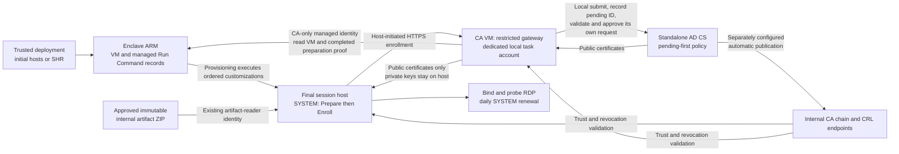
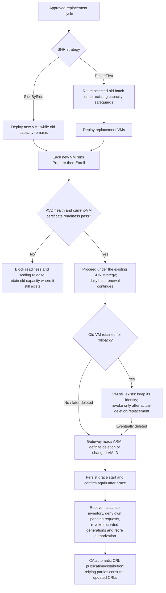

# Host-initiated RDP certificate enrollment

This reference package targets Windows 11 Enterprise multi-session 24H2 and later, with a
non-domain-joined Windows Server 2025 Standalone AD CS issuing CA. It does not use Intune,
host-to-CA NTLM authentication, host identity tokens, Key Vault passwords, Marketplace products,
or CA-to-host Run Command.
The unattended path uses a **CA-side, read-only managed identity** to verify provisioning evidence.

**Qualification status:** offline-tested reference implementation, not a certified PKI service.
Windows CNG permissions, AD CS issuance, HTTP.sys mutual TLS, task behavior, and actual RDP
certificate presentation require the live qualification below before production use. No access to
Azure Top Secret was available during development. Do not equate passing source/unit tests with
deployment success or an authorization to operate.

Copy this folder into `customer\artifacts\Configure-RdpCertificate` before customization. Do not
deploy it in an image or copy its generated state/keys between hosts.

## Start here: the implementation in five minutes

**Goal:** replace the Windows RDP listener's self-signed certificate on each Entra-joined AVD
session host, without Intune, domain join, or a shared enrollment password on the hosts.
This changes the host's RDP listener certificate, not the AVD broker/gateway certificates.

**Deployment decision:** use the existing **session-host runtime customizations**. This guide
does not use image-build/VDI customization, image staging of this package, or an image-installed
first-boot enrollment task. The startup task described below is created during final-VM
customization as a retry mechanism; it is not the initial trust mechanism.

The short version:

1. **Set up once:** the PKI team prepares a private Standalone AD CS issuing CA, trust/CRL
   distribution and the restricted enrollment gateway on that CA VM.
2. **Authorize provisioning reads once:** give the gateway's separate managed identity read-only
   access to the approved session-host resource group. Configure the approved pool, artifact URI,
   provisioning-script hash and target-cloud ARM endpoint/audience.
3. **Configure deployments once:** publish the customer-owned artifact ZIP and add the two ordered
   customizations to the standard host-pool/session-host template and SHR.
4. **For every new VM:** `PrepareHost` creates that VM's enrollment key; `EnrollHost` obtains its
   client certificate, requests its RDP certificate, installs/binds it, and verifies the actual
   listener. No operator transfers a CSR or approves an individual healthy enrollment.
5. **Keep it working:** a daily SYSTEM task renews certificates. SHR checks provisioning readiness
   for replacements. The gateway retires deleted VM identities; the CA's configured CRL process
   propagates revocation.

Initial infrastructure setup, pilot approval and exceptional recovery still need an operator.
No live Server 2025/Windows 11 or classified-cloud deployment has been qualified by this example.

### Reading paths

| Reader / question | Read next |
| --- | --- |
| Coworker evaluating the design | [Architecture and trust boundary](#architecture-and-trust-boundary), then [Per-host enrollment sequence](#per-host-enrollment-sequence) |
| Operator implementing the unattended solution | [Required Windows CA configuration](#required-windows-ca-configuration), then the [ordered deployment plan](#ordered-deployment-plan) and its linked CA installation procedure |
| Deployment owner wiring initial hosts and SHR | [Configuration files](#configuration-files-for-the-unattended-path), [customization example](sessionHostCustomizations.example.json), and [output-to-input contract](#output-to-input-contract) |
| Operations / incident response | [Readiness and retirement](#readiness-admission-recovery-and-retirement), [operational checkpoints](#operational-checkpoints-and-troubleshooting), and [task behavior](#task-retry-and-renewal-behavior) |
| Pilot approver | [Required live qualification](#target-cloud-pilot); passing offline tests is not deployment acceptance |

### Four identities, four different jobs

| Identity / key | Location | Purpose and permission boundary |
| --- | --- | --- |
| Existing artifact-reader managed identity | Session host | Downloads the approved ZIP from internal storage; blob read only. It is **not** enrollment authorization. |
| Dedicated gateway managed identity | CA VM only | Reads Azure VM identity and completed preparation output. It has no provisioning writes, and its token never goes to the host. |
| Dedicated local gateway task account | CA VM | Runs the HTTPS gateway and uses local AD CS certificate-manager permissions. Its password is not distributed to hosts; it has no **Manage CA** permission. |
| Per-host client enrollment key/certificate | Final session host | Authenticates certificate requests with mutual TLS after bootstrap. SYSTEM/Administrators control its non-exportable machine key. |

The RDP server certificate has a **separate** per-host key, with the additional read permission
needed by `NETWORK SERVICE`. The gateway's own HTTPS server certificate is another separate
certificate, installed by the PKI administrator before onboarding hosts.

Terminology: **CSR** is a public certificate signing request; **FQDN** is the authorized full
host DNS name; **ARM** is Azure Resource Manager; **CRL** is the CA's published revocation list;
**SHR** is Session Host Replacer. An Azure VM resource name can be reused; its **VM incarnation
ID** (`properties.vmId`) distinguishes the old VM from its replacement.

## Architecture and trust boundary



Arrows show logical interactions, not new inbound guest-management requirements. Only the trusted
deployment executes Run Commands on a host. The gateway's ARM connection is **read only**; it
does not execute commands on a host. Bootstrap uses server-authenticated HTTPS plus independently
verified provisioning evidence; later RDP/credential requests also require a client certificate.

`/certsrv` by itself cannot enforce this package's per-host issuance policy. This package adds a
separate HTTPS API at `/enrollment/bootstrap`, `/enrollment/rdp` and `/enrollment/credential`; it does not scrape the
`/certsrv` HTML pages, replace the AD CS policy module, or provide a web administration dashboard.
Existing `/certsrv` may remain for authorized administrative bootstrap, but hosts do not use it.

All host orchestration runs on the session host. The server component authenticates, validates and issues incoming requests, and reads Azure
provisioning records; it never connects to or executes commands on a session host.

The gateway is a privileged certificate issuer. It runs under a dedicated non-administrative local
account with **Read**, **Request Certificates**, and **Issue and Manage Certificates** on a dedicated
issuing CA, not **Manage CA**. Restrict its logon rights and protect its configuration and code as
CA infrastructure. Application compromise can abuse its issuance permissions: the application is
the authorization boundary, not a sandbox around those CA permissions. If your authorization
requires an independently enforced HSM/CA policy boundary or a supported high-availability
enrollment product, use an approved product instead of this reference gateway.

The host's enrollment key is a persistent, non-exportable RSA-3072 machine key. Only SYSTEM and
Administrators receive file permissions. It is separate from the RDP key; only the RDP key grants
`NETWORK SERVICE` read access. Local administrators/SYSTEM remain trusted and can use machine keys.
This does not defend against compromise of the host operating system. Non-exportability is not
hardware attestation, and software key storage is not a claim of FIPS validation.

No **host** managed identity is accepted as enrollment authorization. Azure VM managed identities are a VM-level boundary:
ordinary session users can request their tokens. This is why a host identity is not granted access
to a shared enrollment secret. The gateway's separate identity has only VM/Run Command read access;
it cannot run commands, modify VMs, or change authorization tags. Its token never goes to a host.
Provisioning writers, artifact publishers, CA administrators and guest SYSTEM/administrators are
trusted. This is provisioning attestation, **not** TPM/Entra device attestation.

## Dependencies and offline transfer

| Disposition | Dependency | Runtime destination |
| --- | --- | --- |
| Manually stage through the approved process | This complete script package and customer-owned configurations | Host and CA VM |
| Manually stage / approved internal distribution | Supported PowerShell 7.4+ x64, including its .NET runtime | Host and CA VM |
| Existing Windows payload / approved internal source | Windows Server 2025 AD CS CA role | CA VM |
| Internally hosted | HTTPS enrollment DNS name, server certificate and HTTP.sys binding | CA VM, approved private port |
| Internally hosted | CA certificates and current CRLs, including any intermediate CRLs | Enclave-local AIA/CDP endpoints |
| Link-local Azure dependency, all host modes | VM compute IMDS for incarnation binding | Link-local IMDS on the session host |
| Enclave-local Azure dependency, unattended path | Managed Run Command instanceView, gateway managed identity and ARM read API | Link-local identity IMDS and approved enclave ARM endpoint from CA VM |
| Trusted provisioning, manual alternative | Initial host client certificate and per-host public-key authorization | Host machine store and server allowlist |
| Unresolved until live qualification | Approved runtime version, cryptographic configuration, enclave networking, RDP behavior | Target authorization boundary |

There are **no runtime software downloads**, public URLs, public identity endpoints, Azure SDK
modules, or marketplace dependencies. Stage a specifically approved PowerShell release using the
neighboring [PowerShell package](../Microsoft-PowerShell-7/README.md); do not execute a
latest-release download inside the enclave. Follow the [air-gapped transfer guide](../../../docs/air-gapped-clouds.md).
All host modes require compute IMDS for VM-incarnation binding. The unattended path additionally
requires gateway identity IMDS and enclave-local ARM access. Configure the
gateway's `ArmEndpoint` and `ArmAudience` from the authorized target-cloud environment; do not
infer Secret/Top Secret URLs from public cloud names. Confirm managed Run Command API
`2023-03-01`, VM API `2022-03-01`, IMDS compute API `2021-02-01`, and managed-identity token API
`2018-02-01` in the target enclave. The existing customization wrapper independently selects
its storage-token API for that cloud. No public login flow or Azure SDK is used by this package.

## Required Windows CA configuration

Complete these steps using approved PKI administration procedures. The installer intentionally does
not modify CA policy, trust stores, firewall rules, HTTP.sys bindings, or security baselines.

1. Prefer an offline root and a dedicated online **Standalone Subordinate CA** for this workload.
   A Standalone Root is supported for a lab, but is not the recommended production hierarchy.
   Use approved CA key protection, signature algorithms, backup and recovery controls.
2. Keep the Microsoft default policy module and **Set the certificate request status to pending**.
      The gateway checks `RequestDisposition & 0x100` before every submission/approval. Do not enable
   global automatic issuance. The gateway approves only request IDs it submitted and recorded.
3. Keep `EDITF_ATTRIBUTESUBJECTALTNAME2` disabled. Do not add a template name or permit arbitrary
   subject/SAN request attributes. This package rejects extra attributes and extensions.
4. Configure end-entity validity to exceed the renewal window, with sufficient operational margin,
   and not exceed `MaximumValidityDays` (at most 397 days, including backdating).
   Ensure the issuing CA and its chain remain valid throughout that period.
   Validate the effective lifetime, not just registry settings.
5. Confirm the CA honors these exact requested extensions:
   - Basic constraints: not a CA, critical.
   - RDP key usage: digital signature and key encipherment, critical.
   - Enrollment credential key usage: digital signature only, critical.
   - Exactly one noncritical EKU: Server Authentication (`1.3.6.1.5.5.7.3.1`) for RDP,
     or Client Authentication (`1.3.6.1.5.5.7.3.2`) for the enrollment credential.
   - Exactly one noncritical DNS SAN, equal to the authorized lowercase host FQDN.
   - RSA keys at least 3072 bits; SHA-256/384/512 RSA certificate signatures.
   Only noncritical SKI, AKI, CDP and AIA metadata may be added by the CA. A CA configuration that
   strips required extensions or adds other extensions fails closed and needs qualification.
6. Publish current CRLs and issuer certificates to stable, enclave-local HTTP locations.
   Bootstrap the approved roots/intermediates into the **Local Machine** stores on hosts and the
   CA VM using independently verified SHA-256 fingerprints. Configure trust on scanners too.
   Both application and TLS revocation validation remain enabled; do not use public AIA/CDP URLs,
   disable certificate checks, or rely on interactive-user trust stores.
   Configure **automatic CA CRL publication and distribution** with a maximum revocation latency
   approved for this workload; validate scheduling, overlap, caches and every CDP from a client.
   The gateway records revocations using certificate-manager rights; it deliberately does not gain
   **Manage CA** to publish CRLs. The CA's separate native publication/distribution process must
   propagate them unattended, including after a CA reboot. A CA database revocation alone is not
   evidence that clients have consumed a new CRL. Alert on publication/distribution failures.
7. Create a dedicated local gateway account. Grant it **Log on as a batch job** and the three CA
   permissions above; do not grant local administrator, **Manage CA**, or interactive/RDP logon.
   Ensure applicable deny-logon policies do not prevent the task. Enforce service-account password
   management through the approved operator process.
8. Restrict inbound connectivity to the private HTTPS enrollment endpoint from approved host
   networks. Hosts need no inbound connectivity for enrollment. Do not expose CA RPC/DCOM,
   `/certsrv`, management interfaces, or RDP to hosts merely to support this package.
9. Enable Certificate Services auditing and forward the protected application audit log and task
   failures to approved monitoring. Secure and back up the CA database and gateway state together.
   Set operational alerts well before credentials or CRLs expire.

The gateway has one serial request-processing loop. It is not a high-availability or
internet-facing web server. HTTP.sys timeouts and body limits reduce resource use but do not
replace network isolation, capacity testing and denial-of-service controls.

## Configuration

Create these files outside the tracked example, for example in your git-ignored customer folder.
The SHA-256 pins below are **certificate DER hashes**, not the SHA-1 thumbprints used by RDP.
`EnrollmentPublicKeySha256` hashes DER SubjectPublicKeyInfo, not the certificate.

### Configuration files for the unattended path

| Example | Customer-owned location / consumer | What to customize |
| --- | --- | --- |
| [host.json](host.json) | Inside the host artifact ZIP, beside its root script | DNS suffix, HTTPS enrollment URL, independently verified CA pins, validity/renewal limits and RDP port |
| [server.example.json](server.example.json) | Separate protected configuration delivered to the CA VM; **not inside the host ZIP** | CA name/pins, `Hosts: []`, enabled bootstrap, approved Azure scope/pool, artifact URI, wrapper hash, ARM endpoint/audience and gateway identity client ID |
| [gateway-role.example.json](gateway-role.example.json) | Trusted management workstation; Azure custom-role definition | Session-host resource-group scope; preserve the two read-only Actions |
| [sessionHostCustomizations.example.json](sessionHostCustomizations.example.json) | Merge into each complete initial-host and SHR parameter file | Same approved artifact URI in both entries; preserve exact names, order and arguments |

The unattended host example uses `DnsSuffix` so a single artifact works across replacement host
names. `DnsName` in the inline example below is instead for the **manual alternative**.
The host always verifies the computer name and final VM incarnation; a configuration file is not
permission to request a different machine's certificate.

### Manual configuration reference

These inline examples support [manual trusted bootstrap](#one-time-trusted-bootstrap), not the
recommended unattended path. Do not populate per-host `Hosts` entries when following the unattended
deployment plan; start with the linked unattended examples above.

Manual host configuration:

```json
{
  "DnsName": "avd001.example.internal",
  "EnrollmentUrl": "https://enroll.example.internal:8443/enrollment/",
  "RootCaSha256": "<64 uppercase hex characters>",
  "IssuingCaSha256": "<64 uppercase hex characters>",
  "MaximumValidityDays": 397,
  "RenewBeforeDays": 30,
  "RdpPort": 3389
}
```

The FQDN's first label must match the computer name. Wildcards, aliases, IP SANs and additional
names are deliberately unsupported. If the scanner connects by IP and performs name validation,
configure it to validate the approved FQDN or use an separately reviewed certificate profile.

Manual server configuration:

```json
{
  "Prefix": "https://enroll.example.internal:8443/enrollment/",
  "CaConfig": "CA01\\Example RDP Issuing CA",
  "RootCaSha256": "<64 uppercase hex characters>",
  "IssuingCaSha256": "<64 uppercase hex characters>",
  "MaximumValidityDays": 397,
  "RenewBeforeDays": 30,
  "Hosts": [
    {
      "DnsName": "avd001.example.internal",
      "EnrollmentPublicKeySha256": "<hash reported by PrepareHost>"
    }
  ]
}
```

Read configuration and state only from the protected installation directory. The server reads its
allowlist at startup: after approved changes, restart its specific scheduled task. Remove retired
hosts from the allowlist and revoke their enrollment certificates. Never reassign an old enrollment
key to a replacement VM. This static allowlist is only for the manual alternative below.
For unattended replacement, use `Hosts: []` and the `Bootstrap` object in
[server.example.json](server.example.json). Dynamic authorizations are read from protected state
on each request; normal VM replacement needs no allowlist edits or server-task restart.

## Unattended session-host customization and SHR deployment

This is the recommended automation path. Initial PKI, trust, gateway and Azure authorization setup
is still an operator responsibility; **per-host onboarding, renewal and retirement are automated
after that setup**. Copy the example before editing. The JSON files contain intentionally invalid
placeholders, not deployable secrets or enclave endpoint assumptions.

### Ordered deployment plan

1. Prepare existing networking, enclave DNS, CA hierarchy, automatic CRL publication/distribution,
   gateway HTTPS certificate/binding, and independent host/CA chain trust. Follow
   [Required Windows CA configuration](#required-windows-ca-configuration) before installing the
   gateway. Approved PowerShell 7.4+ x64 must be available on the CA VM and each final host; if not
   already installed, deploy it through an earlier approved offline runtime customization.
   No image-build/VDI customization or image-staged certificate task is used for this package.
   The gateway machine must have no untrusted interactive users; any local process can request
   its managed-identity token.
2. Deploy Image Management **only if artifact storage is not already available**. An image build
   is **not required by enrollment**. Reuse an approved OS image and existing internal
   artifact storage where available. No new standalone Shared Services deployment or Key Vault
   secret is required by certificate enrollment.
3. Copy the reference package before editing. For example, from the repository root:

   ```powershell
   if (Test-Path .\customer\artifacts\Configure-RdpCertificate) {
       throw 'Use the existing customer package deliberately; do not overwrite it with this copy example.'
   }
   if (Test-Path .\customer\parameters\rdpCertificate) {
       throw 'Use a new configuration directory or preserve the existing configuration deliberately.'
   }
   New-Item -ItemType Directory -Path .\customer\artifacts -Force | Out-Null
   New-Item -ItemType Directory -Path .\customer\parameters\rdpCertificate -Force | Out-Null
   Copy-Item -LiteralPath .\customer-examples\artifacts\Configure-RdpCertificate `
       -Destination .\customer\artifacts -Recurse
   Copy-Item -LiteralPath .\customer-examples\artifacts\Configure-RdpCertificate\server.example.json `
       -Destination .\customer\parameters\rdpCertificate\server.json
   Copy-Item -LiteralPath .\customer-examples\artifacts\Configure-RdpCertificate\gateway-role.example.json `
       -Destination .\customer\parameters\rdpCertificate\gateway-role.json
   ```

   Use a new customer destination; do not overwrite an existing customized package/configuration.
   Keep the real server configuration separate from the artifact. The `.example.json` files in
   the reference package contain placeholders, not actual CA credentials/configuration.
   Configure the customer copy of [host.json](host.json). Set the authorized `DnsSuffix`, private
   endpoint, verified CA DER pins and policy limits. The host derives its lowercase FQDN from its
   actual computer name and this suffix. Include `host.json` beside the root script in the ZIP.
   The installed hostname must agree with the VM's Azure `osProfile.computerName`.
4. Package this **one** customer folder using the documented artifact packaging workflow. For an
   already prepared/offline customer tree, an example packaging-only command is:

   ```powershell
   .\deployments\Update-ImageArtifacts.ps1 -PackageOnly `
       -SkipDownloadingNewSources -CustomerRootPath .\customer `
       -OutputPath 'C:\approved\packages'
   ```

   Explicitly select `Configure-RdpCertificate.zip`, not every output of the packaging command.
   Publish that ZIP as an approved **immutable versioned blob**, for example
   `Configure-RdpCertificate-v1.zip`. Its root must contain exactly one `.ps1` entry point.
   Preserve the helper directory and JSON files. Use the existing managed-identity artifact
   download path, not a SAS/password in the URI. Protect the content against modification at
   that approved URI (for example a locked immutable blob with an approved retention policy).
   Only trusted publishers may write it; session-host identities need blob **read only**.
   Use the [artifact upload procedure](../../../docs/update-image-artifacts.md) in the authorized
   target-cloud context, and publish the versioned blob through your approved storage process.
   Record its final URI before configuring the gateway; default artifact filenames are not
   automatically immutable/versioned. Do not enable a delete-existing-blobs workflow against the
   immutable enrollment package.
5. Attach a dedicated CA-only managed identity to the gateway VM. Create the custom role from
   [gateway-role.example.json](gateway-role.example.json), replacing its scope, and assign it to
   that identity at the session-host VM resource group. Its only Actions are
   `Microsoft.Compute/virtualMachines/read` and
   `Microsoft.Compute/virtualMachines/runCommands/read`, with no DataActions.
   **Never attach that identity to session hosts**, grant it VM/Run Command/tag writes, or give
   guest identities those writes. Likewise, a session user must not have Azure permissions to
   replace preparation commands, alter the VM/ownership tag, publish the artifact, or run guest
   code as SYSTEM. Provisioning identities remain trusted administrators.
   After editing the customer role JSON's `AssignableScopes`, an authorized management operator
   can create/assign it in the already selected target-cloud context:

   ```powershell
   $role = New-AzRoleDefinition -InputFile .\customer\parameters\rdpCertificate\gateway-role.json -ErrorAction Stop
   New-AzRoleAssignment -ObjectId '<CA-only-managed-identity-principal-object-guid>' `
       -RoleDefinitionId $role.Id `
       -Scope '/subscriptions/<subscription-guid>/resourceGroups/<hosts-rg>' -ErrorAction Stop
   ```

   These two commands **write Azure RBAC**; review the target identity/scope and authorize them
   before execution. If the role already exists, review/reuse it through the approved RBAC process
   instead of blindly creating or replacing it. The assignment uses the identity's **principal /
   object ID**; `ManagedIdentityClientId` in the gateway configuration uses its different **client ID**.
6. Configure a separate CA-local copy of [server.example.json](server.example.json). Set the
   approved cloud's ARM endpoint and token audience, the CA-only identity's **client** GUID
   (`null` selects the CA VM's system identity), exact resource-group and host-pool IDs, matching
   DNS suffix, exact immutable artifact URI, and normalized approved wrapper-source SHA-256.
   Obtain the pin from the source used to publish the **actual session-host Template Spec**:

   ```powershell
   . .\customer-examples\artifacts\Configure-RdpCertificate\scripts\Common.ps1
   Get-ProvisioningScriptHash (
       Get-Content .\deployments\shared\scripts\Invoke-Customization.ps1 -Raw
   )
   ```

   Run this with PowerShell 7.4+ on a trusted management machine. It normalizes BOM/CRLF only;
   whitespace/content changes otherwise require a new approved pin. Do not copy a hash from an
   untrusted running VM. Keep server configuration, passwords and all generated state **out of
   the host artifact**. Install/start the gateway using
   [CA-side HTTPS endpoint installation](#ca-side-https-endpoint-installation).
   Verify that task is running, TLS/CRL paths are reachable and authorized enrollment works in the
   pilot; a successful `Start-ScheduledTask` is not proof the API is healthy.
7. Merge `parameters.sessionHostCustomizations` from
   [sessionHostCustomizations.example.json](sessionHostCustomizations.example.json) into the
   existing complete **standard host-pool** or standalone
   [session-host template](../../../deployments/add-ons/sessionHosts/README.md) parameters.
   This example is a parameter **fragment**, not a complete deployment file. Set both
   `blobNameOrUri` values to the same approved URI and set up the existing artifact reader
   identity. Other customizations may precede this pair, including a fully pre-staged runtime
   installer; do not interpose anything that changes keys, hostname or configuration.
   Keep the exact names and arguments:

   | Order | Managed Run Command name | Arguments |
   | --- | --- | --- |
   | 1 | `RdpCertificate-Prepare` | `-Mode PrepareHost` |
   | 2 | `RdpCertificate-Enroll` | `-Mode EnrollHost` |

   The existing template serializes these commands. `PrepareHost` creates or reuses only the
   same final-VM identity and emits a compact public proof. **It must finish first**: a command
   cannot use its own unfinished stdout as trusted execution evidence. `EnrollHost` bootstraps,
   enrolls and probes synchronously. Success is returned only after binding, presentation and
   targeted cleanup; HTTP 429/server errors during bootstrap have bounded logged retries.
8. Configure **the same pair** in SHR's `sessionHostCustomizations`, with the same artifact
   access inputs and approved session-host Template Spec version, and deploy the updated SHR
   template from this branch (its ARM embeds the updated function code). Republish/redeploy that
   template; an older published SHR Template Spec does not acquire these changes automatically.
   Existing SHR VM permissions must include VM and managed
   Run Command reads. Enable the normal rollout only after the pilot below.
   No certificate-specific Bicep parameter or guest enrollment secret is introduced.
   Adding the pair to SHR does not retrofit existing VMs or force an image-update cycle. Onboard
   an existing fleet through its trusted customization deployment, or replace it through the next
   approved image rollout; existing same-image VMs without enrollment evidence fail the opt-in gate.

### Per-host enrollment sequence

This sequence runs on **every final VM**, including replacements. Preparation and enrollment are
two executions of the **same ZIP**, not two different packages. Relative `ConfigurationPath`
values resolve beside the artifact entry point; the supplied arguments use the bundled `host.json`.

```mermaid
sequenceDiagram
    participant D as Trusted deployment
    participant A as Enclave ARM
    participant H as Final host SYSTEM
    participant G as CA HTTPS gateway
    participant C as Local Standalone AD CS
    D->>H: Run RdpCertificate-Prepare
    H->>H: Read local VM identity and create protected enrollment key/CSR
    H-->>A: Complete Prepare; record public key/CSR hashes and VM incarnation
    D->>H: After Prepare succeeds, run RdpCertificate-Enroll
    H->>H: Install retry/startup and daily renewal tasks
    H->>G: HTTPS bootstrap: public CSR and VM resource ID; no client certificate yet
    G->>A: Read current VM and completed Prepare command using CA-only identity
    A-->>G: VM incarnation, ownership tag, source, arguments and public proof
    G->>G: Verify scope, approved source/artifact, freshness, key and CSR profile
    G->>C: Submit credential CSR; hold pending
    C-->>G: Pending request ID
    G->>G: Persist own request ID before approval
    G->>C: Approve that validated request and retrieve certificate
    C-->>G: Issued public client certificate
    G-->>H: Return checked public client certificate
    H->>H: Associate certificate with existing SYSTEM-only key
    H->>G: Mutual TLS: request RDP certificate with a separate host key
    Note over G,C: Validate current VM and exact profile; repeat recorded pending/approval workflow
    G-->>H: Return checked public RDP certificate
    H->>H: Install, grant RDP key access, bind listener and perform actual TLS probe
    H->>H: After success, targeted old-cert cleanup and delete bootstrap task
    H-->>A: Complete Enroll with current-VM FEDERALAVD_RDP_READY marker
    Note over H: Daily renewal task remains installed
```

    The host-to-ARM return arrows represent Run Command stdout/completion captured by the Azure VM
    agent/platform, not ARM writes performed by the enrollment script or its managed identity.
    Failure at any trust, issuance, binding or probe step prevents a successful readiness result.
A readable CSR, public certificate or VM resource ID does not let a session user use the protected
private key. The startup task cannot replace the trusted Azure preparation record; do not substitute
an image-only scheduled-task bootstrap for these two customizations.

### Output-to-input contract

| Producer / evidence | Consumer | Required mapping |
| --- | --- | --- |
| Existing/new artifact storage | Standard host-pool/session-host template and SHR | Existing artifact container/reader identity inputs, or full immutable `blobNameOrUri` |
| Approved packaged ZIP | Gateway `Bootstrap.ArtifactUri`; both customizations | Identical resolved HTTPS URI; no SAS, redirects or mutable content |
| Published template's wrapper source | Gateway `Bootstrap.PrepareScriptSha256` | Normalized source SHA-256, not a ZIP hash |
| Current Azure VM | Gateway and SHR | ARM ID plus immutable `properties.vmId`; a reused hostname alone is insufficient |
| VM `cm-resource-parent` ownership tag | Gateway `Bootstrap.HostPoolResourceId` | Exact approved pool; do not override the template's ownership tag |
| SYSTEM Prepare stdout + completion | Gateway bootstrap authorization | Matching CSR/SPKI hashes, VM ID, resource ID and derived FQDN; default maximum age 120 minutes |
| Synchronous Enroll stdout + completion | SHR replacement readiness | Successful command/exit code and one current-VM `FEDERALAVD_RDP_READY` record |

The gateway does not trust a submitted hostname, a readable public CSR/certificate, a guest identity
token, or the ownership tag alone. It independently reads ARM, validates source/parameters and fresh
completion, verifies the CSR signature/profile, and pins its public key to the VM incarnation.
Reading/copying proof does not give a session user the SYSTEM-only private key. Changing the
approved artifact, wrapper or authorization scope requires a trusted configuration rollout.
This is a one-pool/one-resource-group gateway configuration; broader multi-pool policy is not implied.

### Readiness, admission, recovery and retirement

For opted-in pools, SHR checks the enrollment command and current VM identity before recording
image-validation tags, counting online or scalable-standby replacements, or releasing its scaling
exclusion. Failed/missing output and ARM errors block readiness, even when AVD reports `Available`.
Pools without the reserved enrollment customization keep their previous behavior and need no extra
certificate ARM reads. **SideBySide** can retain old capacity until ready; **DeleteFirst** still
deletes its selected batch before deploying replacements and cannot provide that same guarantee.

This gate is **not a pre-logon admission control**: the AVD agent can register and accept sessions
before customizations finish. Use an isolated pilot pool and approved provisioning/admission controls
if users must never reach an unqualified new host. The package does not change AVD drain state, NLA,
firewalls or Windows logon policy, and does not promise to prevent early sessions.
The stored ready marker proves provisioning-time listener validation, not ongoing certificate health;
monitor the renewal task, audit log, certificate expiry and scanner results separately.



The diagram does not make DeleteFirst nondestructive or make the certificate gate a logon gate.
ARM uncertainty defers retirement; an existing stopped VM is not proof of deletion. Revocation
propagation is separate from the immediate gateway refusal of issuance for a deleted incarnation.

The gateway scans up to 20 persisted identities every 30 seconds in a rotating pass. On an
authoritative VM `ResourceNotFound`/`ResourceGroupNotFound`, or a changed immutable VM ID, it records
a grace-period start (default 60 minutes). A later confirming read after that period revokes **all
recorded certificate generations** for that incarnation and disables its authorization. A retained,
stopped rollback VM with the same ID is not retired. The gateway rejects issuance from a deleted or
changed incarnation immediately, without waiting for the retirement grace period.
Timeouts, malformed/empty responses, unexpected 404s, 403s and service errors do not establish
deletion; they defer retirement and log the failure. Interrupted revocation resumes from persisted
per-certificate state, recovers issued certificates from recorded request IDs if issuance was
interrupted before inventory persistence, and denies its still-pending requests without approving
them. The CA's separate automatic CRL publication/distribution then propagates
revocation; include that schedule and client caching in your revocation SLA.

Routine healthy replacement needs no operator CSR transfer, allowlist edits, credential delivery or
per-VM approval. This is not a promise of autonomous recovery from every failure:

- If provisioning proof expires before bootstrap, rerun the trusted Prepare/Enroll deployment pair
  for that same VM. Preparation reuses only an exact same-VM/name identity; it never silently adopts
  cloned state or changes keys. Certificate expiry/revocation or planned key/CA rollover needs
  separately trusted re-onboarding.
- A failed Enroll managed Run Command remains failed even if its scheduled retry later fixes the
  listener. Reconcile/rerun the trusted customization deployment and verify a new successful
  current-VM readiness marker; do not bypass SHR's gate or merely add an image-validation tag.
- Diagnose `HostFailure`, `ServerRequestFailure`, `BootstrapRetry`, `RetirementDeferred`,
  `RetiredCertificateRevoked`, `IdentityRetired` and `CrlPublicationDue` in protected audit logs.
  Persistent errors must alert an operator. Back up the issuance inventory with the CA database;
  losing it loses automatic revocation coverage for older generations.
- A CRL publication failure, unsupported cloud API/runtime, or listener requiring activation is
  an explicit pilot blocker, not a reason to grant broader rights or disable trust checks.

### Operational checkpoints and troubleshooting

Work through these checks in order. Inspect host state as SYSTEM/elevated administrator and gateway
state under an authorized CA administrative context; ordinary session users should not have access.
The protected installation root on either role is
`C:\ProgramData\FederalAVD\RdpCertificateAutomation`.

| Stage | Required evidence | If it is absent or fails |
| --- | --- | --- |
| Prerequisites | Approved runtime, independent chain trust, reachable DNS/HTTPS/CDPs and configured automatic CRL distribution | Resolve these before enrollment; do not download dependencies from the internet or weaken TLS/revocation checks |
| Gateway | Running `RdpCertificate-EnrollmentServer` task, protected `state\audit.jsonl`, and an authorized pilot request | Check task account/batch rights, CA permissions/policy, HTTP.sys binding, gateway identity reads and target-cloud audience |
| Prepare | Managed Run Command `Succeeded`, exit code 0, and exactly one `FEDERALAVD_RDP_BOOTSTRAP` public-proof record | Check runtime, computer name/configuration, IMDS, protected directory/key access, and that no other VM's state was captured |
| Bootstrap | Gateway `BootstrapAuthorized` and host `AutomaticBootstrapInstalled` audit records | Check approved pool/scope/tag, source pin, exact artifact URI/arguments, proof age, client CSR/key match and ARM reads |
| RDP enrollment | Host `ListenerVerified`, successful Enroll command and one current-VM `FEDERALAVD_RDP_READY` record | Inspect the explicit error; a written binding or installed task is not successful listener presentation |
| Post-success tasks | Bootstrap task absent, renewal task present; successful renewal checked through task/audit evidence | A missing bootstrap task is expected only after success; alert on missing/failed renewal |
| SHR | Replacement readiness passes with the same customization pair and updated deployed SHR code | Keep the gate closed; an `Available` AVD host or manually added validation tag is insufficient |
| Retirement | `RetiredCertificateRevoked` / `IdentityRetired`, followed by verified updated-CRL consumption | Investigate `RetirementDeferred`, inventory/CA backup consistency and CA publication; do not treat an ARM outage as deletion |
| Scanner acceptance | The normal scanner trusts and sees the issued certificate on the actual RDP endpoint, including after reboot | Investigate presented-certificate versus store-inventory findings separately; never delete all self-signed certificates |

For read-only control-plane inspection, connect a trusted management workstation to the authorized
cloud/subscription first, using the [cloud connection guidance](../../../docs/air-gapped-clouds.md).
With Azure PowerShell available, replace the VM resource ID:

```powershell
$vmResourceId = '/subscriptions/<subscription-guid>/resourceGroups/<hosts-rg>/providers/Microsoft.Compute/virtualMachines/<vm-name>'
foreach ($name in @('RdpCertificate-Prepare', 'RdpCertificate-Enroll')) {
    $path = "${vmResourceId}/runCommands/${name}?api-version=2023-03-01&`$expand=instanceView"
    $command = (Invoke-AzRestMethod -Path $path -Method GET -ErrorAction Stop).Content | ConvertFrom-Json
    $command.properties.instanceView |
        Select-Object ExecutionState, ExitCode, StartTime, EndTime, Output
}
```

On the relevant Windows machine, these are read-only local diagnostics:

```powershell
Get-ScheduledTask -TaskPath '\FederalAVD\' -ErrorAction Stop |
    Where-Object { $_.TaskName -like 'RdpCertificate-*' } |
    Select-Object TaskName, State
Get-Content 'C:\ProgramData\FederalAVD\RdpCertificateAutomation\state\audit.jsonl' -Tail 30 -ErrorAction Stop
# Session host only: read-back is useful but does not replace the script's real TLS probe.
Get-CimInstance -Namespace root\cimv2\TerminalServices -ClassName Win32_TSGeneralSetting `
    -Filter "TerminalName='RDP-tcp'" -ErrorAction Stop |
    Select-Object TerminalName, SSLCertificateSHA1Hash
```

These commands do not run the listener probe, approve a request, publish a CRL or repair a task.
Do not post protected logs/state wholesale into tickets or messages; review/redact through the
approved process. A long-running gateway task may report a running task result rather than a
completed success code; use actual policy-authorized enrollment and audit evidence to assess it.

## One-time trusted bootstrap

**Manual alternative:** omit/disable `Bootstrap` and use the static allowlist. There must be an
initial trust decision; a server cannot securely identify a new host solely from
the DNS name supplied in its unauthenticated CSR. This procedure can be performed by an approved
deployment pipeline/operator. It does not require ongoing manual approval of RDP certificates.

1. Stage the package, host configuration and approved PowerShell installation on the **final**
   session host. Run the following as SYSTEM, for example through your existing trusted Run Command:

   ```powershell
   & 'C:\staging\Configure-RdpCertificate\Configure-RdpCertificate.ps1' `
       -Mode PrepareHost -ConfigurationPath 'C:\staging\host.json'
   ```

   This creates the non-exportable enrollment key and
   `C:\ProgramData\FederalAVD\RdpCertificateAutomation\state\enrollment.req`.
   It outputs the enrollment public-key hash for the CA allowlist. It does not install tasks or
   contact a CA. An exact same-VM retry is idempotent; another VM/name is rejected.

2. Transfer the **public CSR only** to the CA through trusted provisioning. Independently verify
   the intended host and public-key hash; do not authorize a hash supplied by a session user.
   Submit and approve the credential CSR using an authorized operator, for example:

   ```powershell
   certreq.exe -submit -config 'CA01\Example RDP Issuing CA' enrollment.req
   # Review and issue this request in the CA console, recording its request ID.
   certreq.exe -retrieve -config 'CA01\Example RDP Issuing CA' <request-id> enrollment.cer
   ```

   Check every native command's exit code. This administrative bootstrap uses the public CSR,
   not an exported private key. The resulting client certificate must match the exact credential
   profile above. Add the independently verified public-key hash/FQDN to the server allowlist.

3. Deliver the public `enrollment.cer` response to that same host. After the server is ready,
   run as SYSTEM:

   ```powershell
   & 'C:\staging\Configure-RdpCertificate\Configure-RdpCertificate.ps1' `
       -Mode InstallHost -ConfigurationPath 'C:\staging\host.json' `
       -EnrollmentCertificatePath 'C:\staging\enrollment.cer'
   ```

   The response's key, profile, issuer, root, validity and revocation are checked before task
   registration. No password, bearer token, shared identity or private key crosses to the host.
   Initial onboarding is approval-gated; subsequent issuance and renewal are unattended.

## CA-side HTTPS endpoint installation

1. Stage the same package and server configuration on the CA VM. Install a distinct, approved
   Server Authentication certificate for `enroll.example.internal` in `LocalMachine\My`,
   with its private key accessible to HTTP.sys/SYSTEM. This is not a host enrollment credential.
2. Reserve the exact URL for the local service account and configure an otherwise unused
   private IP/port binding. Example commands run elevated; replace every placeholder and use a
   unique application GUID. Do not modify an existing IIS binding:

   ```powershell
   netsh http add urlacl url=https://enroll.example.internal:8443/enrollment/ user=CA01\RdpEnrollmentSvc
   netsh http add sslcert ipport=<private-ip>:8443 certhash=<server-cert-SHA1-thumbprint> `
       appid='{<unique-application-guid>}' certstorename=MY `
       clientcertnegotiation=enable verifyclientcertrevocation=enable usagecheck=enable
   netsh http show urlacl
   netsh http show sslcert
   ```

   Check exit codes. Keep server-wide TLS policy at the approved baseline; the application does
   not change it. Require TLS 1.2 or newer and disable legacy protocols on this dedicated endpoint.
   The native binding must negotiate client certificates and validate their revocation. The
   application requires and validates the client certificate on the RDP/credential routes.
   `/enrollment/bootstrap` deliberately permits a TLS connection without a client certificate,
   but requires independently verified provisioning proof before issuance. Do not configure an
   upstream layer to require client certificates on that bootstrap route. `Anonymous` in the
   HttpListener code means no HTTP password authentication, **not unrestricted issuance**.
3. Apply the required firewall/NSG restrictions. Bootstrap chain trust and verify CRL reachability
   from the gateway account and SYSTEM, not only an administrator's browser.
4. Install the gateway task from an elevated administrator session:

   ```powershell
   $credential = Get-Credential 'CA01\RdpEnrollmentSvc'
   & 'C:\staging\Configure-RdpCertificate\Configure-RdpCertificate.ps1' `
       -Mode InstallServer -ConfigurationPath 'C:\staging\server.json' `
       -ServerTaskCredential $credential
   Remove-Variable credential
   ```

   Supply the credential interactively or through an approved protected provisioning mechanism.
   Do not put its password in scripts, Run Command payloads, logs or command-line arguments.
   Task Scheduler stores the task logon credential; it is not distributed to hosts.
   The account can read code/configuration and modify only the gateway state directory.

Except for the provisioning-attested bootstrap route, the gateway accepts only a valid, unrevoked
client certificate with a static or dynamically authorized public key.
It rejects other subjects, extra SANs, extra EKUs, CA capability, weak keys, invalid signatures,
extra attributes/extensions, unexpected JSON fields, redirects and non-HTTPS requests. Credential
renewal preserves the authorized enrollment public key; key rotation requires trusted re-onboarding.

The configuration pins one issuer and root at a time; dual-issuer rollover is not implemented.
Plan a coordinated, trusted credential re-onboarding/configuration update for CA rollover rather
than changing the pins and expecting old credentials to renew automatically.

## Task, retry and renewal behavior

Installation creates `C:\ProgramData\FederalAVD\RdpCertificateAutomation` with protected code,
configuration and `state`. SYSTEM/Administrators control the host directory; the CA service account
has read-only code/configuration access and modify access to its separate state directory.

- `\FederalAVD\RdpCertificate-Bootstrap`: runs at startup, starts immediately for manual installation
  (the unattended installer instead runs synchronously), and retries
  every 15 minutes. It unregisters itself only after issuance, RDP binding read-back, successful
  local RDP/TLS presentation validation and targeted old-certificate cleanup.
- `\FederalAVD\RdpCertificate-Renewal`: remains installed; runs daily around 02:00 with up to two
  hours of random delay. It checks/renews the enrollment credential and then the RDP certificate,
  repairs the binding, and probes the listener. Task failures also retry three times.
- `\FederalAVD\RdpCertificate-EnrollmentServer`: CA-side startup task; remains running and restarts
  on failure. It polls Azure VM records for retirement, not the guests, and never executes guest
  commands. Startup success must be verified by a policy-authorized request.

Host operations are serialized by a mutex. The gateway processes requests serially and persists
its own CA request IDs before approval. Retries reuse pending host keys/CSRs and server request
records, including after a lost response. A different request outside the renewal window is
rejected. Records inside the renewal window may be replaced; matching unexpired responses are
reused. An interrupted submit may leave an unapproved orphan request; it is not automatically
approved. Review such orphans rather than granting the host approval permissions.

The gateway validates issued properties and chain before returning the certificate. If those
checks fail, it attempts revocation and records the error; a revocation failure is also an explicit
server failure. Operators must publish the updated CRL and investigate any such event.

No automatic TermService restart or reboot occurs: active AVD users must not be disconnected.
If the binding is written but RDP still presents the old certificate, the task fails visibly and
retains bootstrap/retry state. Activate it through an approved maintenance-window restart/reboot,
then verify the next task succeeds. Do not call the finding fixed based on the registry/WMI value.

Credential renewal retains its SYSTEM-only key; RDP renewal generates a new key. Superseded local
certificates/keys are retained for controlled rollback and require an operator retention/cleanup
policy; automatic VM-incarnation retirement revokes all recorded generations at the CA.
Do not delete the live credential, bound certificate, key files, or state to force a retry.
Expired/revoked enrollment credentials require trusted re-onboarding; there is no password fallback.

## Self-signed certificate handling and scanner acceptance

The script records the former RDP listener thumbprint before changing it. Only after the new
certificate is actually presented over RDP/TLS does it remove that exact former certificate from
`LocalMachine\Remote Desktop`, if its subject/issuer identify the host's self-signed certificate.
It never deletes trusted roots, unrelated self-signed certificates or arbitrary machine keys.
The `SSLCertificateSHA1Hash` property identifies a certificate; it does not require SHA-1 signing.

Windows may create fallback certificates. Removing one is not proof that it cannot recur.
This package does not suppress Windows certificate-generation behavior or remove unidentified
store entries. A scanner reporting an unbound certificate inventory finding, rather than a
certificate presented on the RDP port, needs a separately validated disposition. Check both kinds
of finding after reboot. Do not broaden deletion to all self-signed certificates.

## Required live qualification and operations

### Offline validation

Run from the repository root with the approved development tools:

```powershell
Invoke-Pester -Script .\tests\RdpCertificateArtifact.Tests.ps1,.\tests\RdpCertificateIntegration.Tests.ps1 -PassThru
Invoke-Pester -Script .\tests\SessionHostReplacer.Tests.ps1 -TestName `
    'Session Host Replacer scaling-aware readiness', `
    'Session Host Replacer scaling-aware readiness contracts', `
    'Session Host Replacer shutdown retention scaling protection' -PassThru
az bicep build --file deployments\add-ons\sessionHosts\main.bicep --outfile deployments\add-ons\sessionHosts\main.json
az bicep build --file deployments\add-ons\sessionHostReplacer\main.bicep --outfile deployments\add-ons\sessionHostReplacer\main.json
& .\.github\skills\federalavd-bicep-maintenance\scripts\Test-BicepArmSync.ps1 `
    -BicepPath deployments\add-ons\sessionHostReplacer\main.bicep
Invoke-Pester -Script .\tests\TemplateSpecs.Tests.ps1 `
    -TestName 'Generated ARM and Template Spec size budgets' -PassThru
& .\.github\skills\federalavd-artifact-authoring\scripts\Test-ArtifactPackage.ps1 `
    -ArtifactPath customer-examples\artifacts\Configure-RdpCertificate
git diff --check
```

Inspect the Pester result counts and native exit codes; a normal shell exit alone is insufficient.
The installed Pester 3.4 development runner has unrelated mock/formatting incompatibilities in a
broader SHR test run; the selected readiness suites avoid claiming that broader run is green.
The package has no download-manifest entries: an empty download inventory does not validate its
IMDS/ARM/HTTPS/CDP runtime dependencies or staged PowerShell availability.

### Target-cloud pilot

Use an isolated pilot CA and representative Server 2025 / Windows 11 multi-session builds:

1. Verify signed/approved PowerShell packages, OS baseline, cryptographic requirements, network
   paths and the exact CA extension encoding. Enforce script signing if required; no execution
   policy bypass is included.
2. Perform trusted bootstrap; confirm an ordinary session user cannot open/use either machine key
   or alter scripts, configuration, state or scheduled tasks.
3. Reject missing certificates on RDP/credential routes, untrusted/expired/revoked certificates,
   and bootstrap with missing/mismatched/stale/forged provisioning evidence. Reject wrong public keys, DNS
   names, additional SANs/EKUs, CA requests, weak keys, extra CSR attributes and invalid signatures.
   Confirm failures do not result in approvals in the CA database.
4. Verify healthy issuance, lost response/retry, restart after pending-state persistence, duplicate
   requests, out-of-window requests, actual credential renewal and new-key RDP renewal.
5. Break CRL access and chain trust; verify failure without a silent bypass. Restore access and
   confirm recovery. Test CA expiration, revoked credentials and state/CA backup recovery.
6. Verify private-key permissions and non-exportability, listener binding, actual certificate
   presentation and client compatibility without disabling NLA or changing other RDP policy.
7. Reboot the host and CA, test stopped tasks, and inspect task results plus
   `state\audit.jsonl`. Logs rotate at 5 MiB with one local archive: forward them to durable audit
   storage; local rotation is not a retention policy.
8. Run the actual scanner from its normal network location and trust context, before/after reboot,
   and separately inspect machine-store inventory if that is in scope. Confirm no AVD connectivity
   regressions; this modifies the Windows RDP listener, not AVD broker/gateway certificates.
9. Exercise normal SHR SideBySide, DeleteFirst hostname reuse, retained rollback, failed Enroll,
   stopped standby, missing instanceView and ARM outages. Confirm readiness blocks old-host
   retirement/scaling release where applicable and ordinary users cannot forge provisioning proof.
   Delete a test VM, test grace and automatic revocation of every recorded generation, and verify
   published CRL consumption on a relying party. Test planned key rotation and CA rollover before expiry.

Read `LastTaskResult` and the audit log. Manual installation reports **task installation**, not
successful enrollment; unattended `EnrollHost` instead requires a successful actual listener probe
before returning success. Complete these live checks before scheduling production deployment.

## Authoritative references

- [Standalone CA behavior](https://learn.microsoft.com/en-us/windows-server/identity/ad-cs/certification-authority-role)
- [CA Web Enrollment](https://learn.microsoft.com/en-us/windows-server/identity/ad-cs/certificate-authority-web-enrollment)
- [CA pending-first policy algorithm](https://learn.microsoft.com/en-us/openspecs/windows_protocols/ms-wcce/f1bcc8fb-2336-4247-9d8f-57ef472a7bd5)
- [AD CS submission API](https://learn.microsoft.com/en-us/windows/win32/api/certcli/nf-certcli-icertrequest-submit)
- [AD CS approval API](https://learn.microsoft.com/en-us/windows/win32/api/certadm/nf-certadm-icertadmin-resubmitrequest)
- [.NET CSR loading and signature validation](https://learn.microsoft.com/en-us/dotnet/api/system.security.cryptography.x509certificates.certificaterequest.loadsigningrequestpem)
- [HTTP.sys configuration](https://learn.microsoft.com/en-us/windows-server/administration/windows-commands/netsh-http)
- [RDP listener binding and NETWORK SERVICE private-key access](https://learn.microsoft.com/en-us/troubleshoot/windows-server/remote/remote-desktop-listener-certificate-configurations)
- [Managed identity security boundary](https://learn.microsoft.com/en-us/entra/identity/managed-identities-azure-resources/managed-identities-faq#what-is-the-security-boundary-of-managed-identities-for-azure-resources)
- [Managed Run Command GET and instanceView](https://learn.microsoft.com/en-us/rest/api/compute/virtual-machine-run-commands/get?view=rest-compute-2023-03-01)
- [Azure Instance Metadata Service](https://learn.microsoft.com/en-us/azure/virtual-machines/instance-metadata-service)
- [AD CS revocation, CRL publication and distribution](https://learn.microsoft.com/en-us/windows-server/identity/ad-cs/operate-certificate-revocation-crl-cdp)
