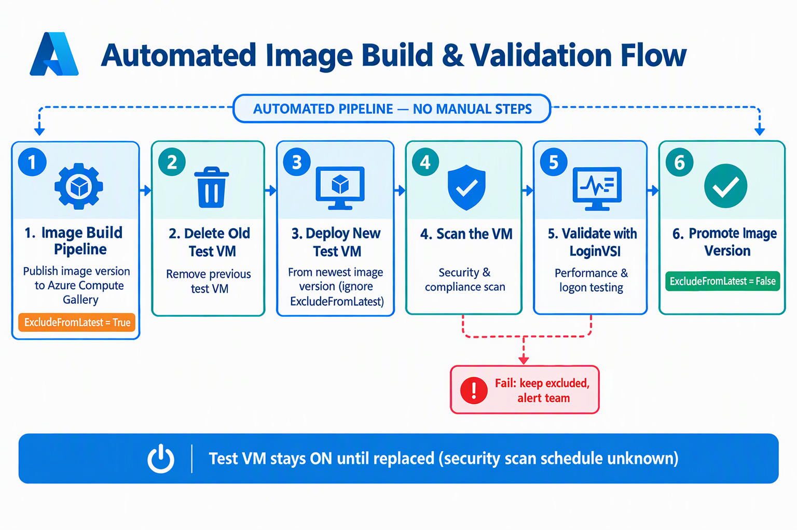

# Image Validation Add-On



[main.bicep](./main.bicep) deploys infrastructure for a scheduled validation VM:
a resource group, Windows PowerShell Function App, runtime storage, encryption
Key Vault and keys, storage encryption identity, VM NIC, and VM Template Spec.
It creates a Windows Dedicated App Service plan unless an existing plan is
selected. Disk encryption and disk-access infrastructure are optional.

The timer deploys a VM from the latest image version in the selected Compute
Gallery image definition. Security teams can scan this VM before approving an
image. The add-on does not perform security approval or promote an image itself.

## Parameters

Names are **complete, caller-supplied resource names**, not naming-convention
overrides. There are no `identifier`, `namingConvention`, or generated-name
outputs in this entry template. Changing a name can create a different resource;
it does not migrate an existing deployment.

| Parameter | Default / requirement |
| --- | --- |
| `resourceGroupName` | Required; the deployment manages this resource group |
| `functionAppName`, `storageAccountName` | Required globally available names for the Function App and runtime storage |
| `applicationInsightsName` | Required input; Insights is created only when a workspace is supplied |
| `keyVaultName` | Required name for the add-on's encryption Key Vault, separate from the credentials vault |
| `userAssignedIdentityName` | Required name for the storage encryption identity; the Function runtime uses a separate system-assigned identity |
| `templateSpecName` | Required name for the VM deployment Template Spec |
| `virtualMachineName`, `diskName`, `networkInterfaceName` | Required names for the validation VM, OS disk, and NIC; VM name is limited to 15 characters |
| `location` | Subscription deployment location; used for the add-on resource group, infrastructure, and VM |
| `appServicePlanName` | Empty; supply a name when creating a plan |
| `appServicePlanResourceId` | Empty creates a plan; otherwise use an existing same-region Windows Dedicated plan supporting Always On and the selected networking |
| `appServicePlanSku` | `P0v3`; also accepts `P1v3`, `P2v3`, `P3v3`; ignored for an existing plan |
| `imageVersionResourceId` | Required existing Compute Gallery image version ID; the timer derives its image definition from this ID |
| `imageLicenseType` | `Windows_Client`; also accepts `Windows_Server` |
| `virtualMachineSize` | Required VM size compatible with the image, security settings, and region |
| `keyVaultResourceId` | Required existing credentials vault ID containing `LocalAdminUsername` and `LocalAdminPassword`; enable template deployment and authorize deployment principals |
| `subnetResourceId` | Required existing VM subnet; also used for all private endpoints and service-mode subnet rules |
| `privateIPAddress` | Required available static IPv4 address in the VM subnet |
| `endpointType` | `private`; also accepts `service` and `public`; see [networking](#networking) |
| `functionAppDelegatedSubnetResourceId` | Empty; supply a separate same-region `Microsoft.Web/serverFarms`-delegated integration subnet for private or service mode |
| `azureBlobPrivateDnsZoneResourceId`, `azureFunctionAppPrivateDnsZoneResourceId`, `azureKeyVaultPrivateDnsZoneResourceId` | Empty; required for private mode, with existing target-cloud zones linked to the integration VNet |
| `diskEncryptionSetName` | Empty disables the disk encryption set; otherwise creates a set and its encryption key |
| `diskEncryptionType` | `EncryptionAtRestWithPlatformAndCustomerKeys`; also accepts `EncryptionAtRestWithCustomerKey` and `ConfidentialVmEncryptedWithCustomerKey`; used only when a disk encryption set is created |
| `diskAccessName` | Empty; supply a name when selecting `diskNetworkAccess: AllowPrivate` |
| `diskNetworkAccess` | `DenyAll`; also accepts `AllowAll`, `AllowPrivate`; currently not enforced on the managed disk, as described under [limitations](#current-limitations) |
| `diskControllerType` | `SCSI`; also accepts `NVMe` |
| `securityType` | `TrustedLaunch`; also accepts `Standard`, `ConfidentialVM`; verify image/VM-size compatibility |
| `acceleratedNetworking`, `bootDiagnostics`, `encryptionAtHost`, `secureBoot`, `vTpm`, `integrityMonitoring` | Each defaults to `true`; integrity monitoring deploys the Guest Attestation extension |
| `artifactsContainerUri` | Empty; container URI for relative artifact blob names |
| `artifactsUserAssignedIdentityResourceId` | Empty; existing artifact identity attached to the VM when supplied |
| `virtualMachineCustomizations` | `[]`; artifact customizations, described below |
| `schedule` | `0 0 21 * * *`; six-field Functions NCRONTAB expression or supported app-setting reference |
| `timeZone` | `UTC`; also accepts Eastern, Central, Mountain, and Pacific Windows Standard Time identifiers |
| `logAnalyticsWorkspaceResourceId` | Empty disables Insights and Function logs; otherwise uses the existing workspace |
| `privateLinkScopeResourceId` | Empty uses public Insights ingestion/query when monitoring is enabled; supply an existing configured AMPLS for private monitoring |
| `tags` | `{}`; resource-type-keyed tag objects, described below |

There is no public `functionAppAppSettings` or `runCommandSettings` parameter.
The entry template builds the runtime settings and packages the repository timer.

## Runtime behavior

[run.ps1](./scripts/run.ps1) authenticates with the Function's managed identity
and then:

1. Lists image versions under the definition derived from `imageVersionResourceId`
   and selects the numerically highest version returned.
2. Requests replication status and waits for aggregate replication `Completed`
   and provisioning `Succeeded`. Polls are 30 seconds apart, with a 60-attempt limit.
3. Looks up the named validation VM. HTTP 404 means no existing VM; other lookup
   errors terminate the run.
4. If the VM's image version name differs, requests force deletion and polls until
   the VM lookup returns 404, with the same polling interval and attempt limit.
5. Submits an incremental deployment using the VM Template Spec and the latest
   image version, forwarding typed Boolean settings, VM tags, and customizations.

The timer still submits a deployment when the VM already uses the latest version;
it skips deletion in that case. It logs **deployment submitted**, not deployment
succeeded. Check ARM deployment status and artifact results separately.

The [VM wrapper](./modules/validationVirtualMachine.bicep) reads credentials from
the existing credentials vault, reuses the named NIC, and composes the shared VM,
Guest Attestation, and artifact customization modules. The NIC is retained on VM
deletion; the shared VM module configures OS-disk deletion.

### Artifact customizations

Customizations use the shared
[artifact input type](../../shared/modules/orchestration/customizations/types.bicep),
not inline Run Command scripts:

```json
{
  "artifactsContainerUri": "https://<storage-account>.blob.<cloud-storage-suffix>/artifacts",
  "artifactsUserAssignedIdentityResourceId": "/subscriptions/<subscription>/resourceGroups/<image-management-group>/providers/Microsoft.ManagedIdentity/userAssignedIdentities/<identity>",
  "virtualMachineCustomizations": [
    {
      "name": "Example",
      "blobNameOrUri": "Example.zip",
      "arguments": "-Mode Test",
      "successExitCodes": "0,3010"
    }
  ]
}
```

Each entry requires `name` and `blobNameOrUri`; `arguments` and comma-separated
`successExitCodes` are optional. Blob names are relative to the container; full
HTTP/HTTPS URIs are also supported by the shared workflow. Copy and package
artifacts following the [artifacts guide](../../../docs/artifacts-guide.md).
Do not put secrets in arguments.

The wrapper runs customizations only when **both** the artifact identity ID and
customization array are nonempty, including when using full URIs. Provision the
identity's Storage Blob Data Reader access and VM-to-artifact network connectivity
before deployment; this add-on grants identity assignment rights, not blob read
access on the artifact store.

## Networking

The VM subnet and all private endpoints use `subnetResourceId`. Function outbound
VNet integration uses the separate `functionAppDelegatedSubnetResourceId`; VNet
integration does not provide private inbound access.

| Mode | Function App and runtime storage | Encryption Key Vault |
| --- | --- | --- |
| `private` | Public access disabled; app/blob private endpoints in the VM subnet; outbound integration enabled when the delegated subnet is supplied | Public access disabled; private endpoint in the VM subnet |
| `service` | Public endpoints enabled with default-deny rules; the VM and delegated integration subnets are allowed | Public endpoint enabled with default-deny rules allowing the VM subnet and `AzureServices` bypass |
| `public` | Public endpoints enabled without network restrictions | Public endpoint enabled; the entry supplies an empty network ACL object |

For service mode, enable Storage service endpoints on the permitted subnets,
`Microsoft.Web` endpoints for subnet-based inbound Function access, and
`Microsoft.KeyVault` on the VM subnet for the encryption-vault rule. Supply the
delegated integration subnet so the Function can reach its restricted host
storage. The Bicep missing-subnet guard currently covers private mode only.
The deployment does not create subnets or enable their service endpoints.

The shared Function module retains an `AzureCloud` inbound exception and storage
retains `AzureServices` bypass. Service mode therefore is not a subnet-only
allowlist. Network access does not replace managed-identity authorization.
See [App Service subnet restrictions](https://learn.microsoft.com/azure/app-service/app-service-ip-restrictions)
and [Storage subnet rules](https://learn.microsoft.com/azure/storage/common/storage-network-security-virtual-networks).

For private mode, pre-create the cloud-specific blob, Function App, and Key Vault
DNS zones and VNet links. Verify resolution, routing, NSGs, subnet separation,
delegation, available addresses, and any required SCM access. Monitoring remains
separate: private app/storage connectivity alone does not make Insights private.

## Encryption and permissions

The entry creates a Premium, RBAC-enabled, soft-delete/purge-protected encryption
vault. The shared CMK module provisions a storage-named HSM key, rotation policy,
and dedicated encryption identity with key access before Function infrastructure.
When `diskEncryptionSetName` is nonempty, it also provisions that key, the disk
encryption set, and its vault access. The existing `keyVaultResourceId` remains
the VM credentials vault and is not replaced by this encryption vault.

The Function runtime uses a system-assigned identity. The entry grants it:

- Virtual Machine Contributor on the validation resource group.
- A custom subnet-join role on the VM's virtual network.
- A custom Key Vault template-deployment role on the credentials vault.
- Reader on the selected gallery and, when created, the disk encryption set.
- Template Spec Reader on the VM Template Spec.
- Managed Identity Operator on the artifact identity, only when supplied,
  using that identity's resource group/subscription.

The shared Function module assigns runtime host-storage roles. The native timer
uses blob storage; queue/table configuration is disabled by this entry.
The deployment principal needs permissions to create resources/custom roles,
assign roles, join subnets, configure endpoints/DNS, provision keys, and retrieve
deployment credentials. ARM resource ordering does not prove RBAC propagation.
Validate initial deployment, redeployment, runtime startup, and key access in
the target cloud.

## Tags

The Portal uses `Microsoft.Common.TagsByResource`. Parameter files should supply
objects keyed by Azure resource type:

```json
{
  "tags": {
    "Microsoft.Resources/resourceGroups": { "Environment": "Test" },
    "Microsoft.Web/sites": { "Environment": "Test" },
    "Microsoft.Storage/storageAccounts": { "Environment": "Test" },
    "Microsoft.Compute/virtualMachines": {
      "Environment": "Test",
      "Purpose": "ImageValidation"
    }
  }
}
```

The entry selects the resource group, NIC, vault, and disk-access tag objects
directly, and passes the resource-type map to other shared modules. Only
`Microsoft.Compute/virtualMachines` tags are serialized into the timer's `tags`
setting and forwarded to VM deployments. A flat tag object is not a uniform
tagging contract for this add-on. For ARM parameter files, wrap the map inside
the parameter's `value` object.

## Deploy with PowerShell

Save a plain input object under the git-ignored
[customer area](../../../customer/README.md), for example
`customer\parameters\imageValidation\infrastructure.json`. Replace all names,
resource IDs, and DNS zones for your cloud before using this private-mode example:

```json
{
  "resourceGroupName": "rg-test-imgv",
  "functionAppName": "<globally-unique-function-name>",
  "storageAccountName": "<globallyuniquestorage>",
  "applicationInsightsName": "appi-test-imgv",
  "keyVaultName": "<globally-unique-vault>",
  "userAssignedIdentityName": "id-test-imgv-storage",
  "appServicePlanName": "asp-test-imgv",
  "templateSpecName": "ts-test-imgv",
  "virtualMachineName": "vm-test-imgv",
  "diskName": "disk-test-imgv",
  "networkInterfaceName": "nic-test-imgv",
  "imageVersionResourceId": "/subscriptions/<subscription>/resourceGroups/<image-group>/providers/Microsoft.Compute/galleries/<gallery>/images/<definition>/versions/1.0.0",
  "keyVaultResourceId": "/subscriptions/<subscription>/resourceGroups/<credentials-group>/providers/Microsoft.KeyVault/vaults/<credentials-vault>",
  "subnetResourceId": "/subscriptions/<subscription>/resourceGroups/<network-group>/providers/Microsoft.Network/virtualNetworks/<vnet>/subnets/<vm-and-endpoint-subnet>",
  "privateIPAddress": "10.0.0.4",
  "virtualMachineSize": "Standard_D4s_v5",
  "endpointType": "private",
  "functionAppDelegatedSubnetResourceId": "/subscriptions/<subscription>/resourceGroups/<network-group>/providers/Microsoft.Network/virtualNetworks/<vnet>/subnets/<integration-subnet>",
  "azureBlobPrivateDnsZoneResourceId": "/subscriptions/<subscription>/resourceGroups/<dns-group>/providers/Microsoft.Network/privateDnsZones/<cloud-blob-zone>",
  "azureFunctionAppPrivateDnsZoneResourceId": "/subscriptions/<subscription>/resourceGroups/<dns-group>/providers/Microsoft.Network/privateDnsZones/<cloud-app-zone>",
  "azureKeyVaultPrivateDnsZoneResourceId": "/subscriptions/<subscription>/resourceGroups/<dns-group>/providers/Microsoft.Network/privateDnsZones/<cloud-vault-zone>"
}
```

From the repository root, after selecting an authorized subscription and cloud:

```powershell
$inputs = Get-Content customer\parameters\imageValidation\infrastructure.json -Raw |
    ConvertFrom-Json -AsHashtable
New-AzSubscriptionDeployment -Name image-validation -Location eastus `
    -TemplateFile deployments\add-ons\imageValidation\main.bicep `
    -TemplateParameterObject $inputs
```

## Portal form and Template Specs

The [form](./uiFormDefinition.json) contains four steps:

1. **Basics:** subscription and deployment location.
2. **Virtual Machine:** size, gallery/image, credentials, VM subnet/IP, security,
   disks, and optional artifact customizations.
3. **Function App:** new/existing plan, schedule/time zone, networking, DNS zones,
   and monitoring. Integration is selected for private/service modes; DNS controls
   are shown only in private mode. Monitoring defaults to enabled in the form,
   whereas parameter-file deployments omit monitoring by default.
4. **Naming and Tags:** complete resource names and resource-type tags. Replace
   naming placeholders; they are not automatically resolved conventions.

The form clears disabled plan, artifact, DNS, integration, and monitoring inputs.
It binds integrity monitoring to the entry parameter. Selecting platform-managed
disk encryption clears `diskEncryptionSetName`. Schedule validation checks field
count, not NCRONTAB ranges or runtime acceptance. Confirm an existing plan's
Windows OS, region, Always On, and networking support.

The [publisher](../../../tools/New-TemplateSpecs.ps1) includes this add-on when
`-CreateAddOns $true`, packaging [main.json](./main.json) and the form as
**AVD Image Validation**. Its publishing purpose is `image-validation`.
Publishing the entry package does not deploy the Function or validation VM.
Use `-WhatIf` and an isolated `-TemplateSpecNameSuffix` before authorized publication.

Rebuild [validationVirtualMachine.json](./modules/validationVirtualMachine.json)
before the entry JSON, because the entry loads that generated file. Regenerate
consuming entry templates after changes to shared modules. Do not hand-edit ARM.

## Current limitations

- `diskNetworkAccess` is not applied by the VM wrapper, and passing `diskAccessId`
  does not configure disk network restrictions in the current shared VM module.
  Creating disk-access infrastructure does not establish `AllowPrivate` or `DenyAll`
  enforcement on the actual OS disk.
- Image enumeration does not handle an empty list explicitly. Aggregate replication
  completion does not establish availability in the selected VM region.
- VM disappearance does not prove OS-disk cleanup or NIC detachment has completed.
  VM input JSON/Boolean parsing occurs after deletion, so invalid runtime settings
  can fail after removing the previous VM.
- Deployment submission is asynchronous; artifact completion, scan results, and
  image acceptance require separate checks.
- The form only supplies blob private DNS in private Function mode, including
  when disk private access is selected independently.
- Verify PowerShell 7.6, Functions v4, .NET 10, plan SKUs, security/attestation
  settings, and networking availability in each target cloud/region. Pre-stage
  dependencies for restricted environments. Offline tests do not establish
  runtime availability, cross-cloud support, or successful deployment.

## Validation

From the repository root:

```powershell
Invoke-Pester -Script tests\ImageValidation.Tests.ps1,tests\ImageValidationUi.Tests.ps1,tests\ImageValidationTags.Tests.ps1
```

These tests compile the entry Bicep, check current module contracts and Portal
bindings, exercise timer 404/non-404 handling with mocked HTTP requests, execute
deployment-body construction for Boolean/tag/customization serialization, and
measure the entry Template Spec package including its form and publishing allowance.
They require PowerShell 7, Azure CLI/Bicep, compatible Pester, and Az.Resources
for packaging. Node.js is no longer required for tag tests.

For generated-template changes, rebuild first:

```powershell
az bicep build --file deployments\add-ons\imageValidation\modules\validationVirtualMachine.bicep `
    --outfile deployments\add-ons\imageValidation\modules\validationVirtualMachine.json
az bicep build --file deployments\add-ons\imageValidation\main.bicep `
    --outfile deployments\add-ons\imageValidation\main.json
Invoke-Pester -Script tests\TemplateSpecs.Tests.ps1
git diff --check
```

Live validation remains necessary: first deploy/redeploy, scheduled runtime
startup, missing/existing/outdated VM paths, final deployment and customization
results, identity permissions, encryption key access, and private/service network
connectivity. Smoke-test all Portal steps and private/service/public,
new/existing-plan, artifact, and monitoring transitions. Offline checks do not
prove Portal expression evaluation, publication, or Azure deployment success.
