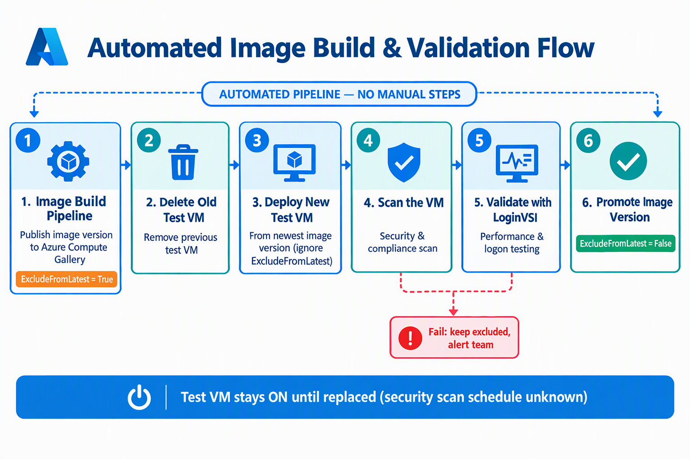

# Image Validation Add-On



[main.bicep](./main.bicep) deploys a resource group, runtime and storage-encryption managed identities, a Premium encryption Key Vault with an HSM-backed storage key, a Windows PowerShell Function App, identity-authenticated runtime storage, and a native timer function named `ImageValidation`. It creates a Dedicated Windows plan unless an existing compatible plan ID is supplied. The deployment composes shared vault, CMK, Function App, hosting-plan, identity, and timer modules; it does not duplicate their resource definitions.

## Centralized naming

The deployment imports `functionAppNames` and `resourceNameForType` from the
[shared naming policy](../../shared/modules/orchestration/naming/README.md).
There is no add-on-specific naming engine or copied abbreviation catalog.

- `identifier` defaults to `iv`, deliberately short enough for generated runtime
  storage names. Use distinct identifiers for independent instances.
- `namingConvention: {}` uses current shared defaults, including component order,
  delimiter, workload, region mappings, type abbreviations, and length limits.
- The resource group is named first with subscription context and an empty
  resource-group field. The resolved group name then supplies the actual context
  for app resources and their deterministic uniqueness seed.
- The app, runtime storage, Insights, storage-CMK identity, and private
  endpoint/NIC patterns come from `functionAppNames`. The group, runtime identity,
  separately owned plan, encryption vault, VM Template Spec, validation VM, OS disk, and NIC use
  `resourceNameForType` with the resolved owning-group context. The corresponding
  resource-type keys are `keyVaults`, `templateSpecs`, `virtualMachines`, `osdisks`, and
  `networkInterfaces`; no local abbreviations or naming recipes are introduced.
- The validation VM name is also its Windows computer name. It must fit the shared
  `namingPolicy.limits.deploymentVm` budget (15 characters). Overlength names fail
  explicitly; shorten the identifier or convention instead of relying on truncation.
- Explicit overrides bypass generation for the group, runtime identity, app,
  storage, encryption vault, and new plan. An existing plan ID skips plan creation entirely.
- `generatedNames` returns all resolved names and endpoint patterns. Patterns are
  resolved by the shared infrastructure module against each endpoint target.
  Insights is created only when a workspace is selected. The storage-CMK identity
  is deployed separately from the runtime identity. The encryption key name is
  exactly the resolved runtime storage account name, including explicit storage
  name overrides; it is not independently convention-generated.

For `eastus` and the default convention, the group is `rg-avd-iv-use`, the app
identity is `uai-avd-iv-use`, and the plan is `asp-avd-iv-use`. The validation VM
is `vm-avd-iv-use`; the OS disk, NIC, and Template Spec use their shared resource
abbreviations with the same identifier and region. App and storage
names include the shared six-character application/scope hash. Changing naming
inputs can create different resources; it does not migrate an existing instance.

The unused draft `namingComponentOrder` parameter is replaced by the shared
`namingConvention` contract.

## Parameters

| Parameter | Default / requirement |
| --- | --- |
| `location` | Subscription deployment location |
| `identifier`, `namingConvention` | `iv`, `{}` |
| `resourceGroupNameOverride`, `userAssignedIdentityNameOverride` | Empty generates names; the deployment manages the selected group and identity |
| `functionAppNameOverride`, `storageAccountNameOverride` | Empty generates names; supply globally available explicit names as needed |
| `appServicePlanNameOverride` | Empty generates the new plan name; ignored for an existing plan ID |
| `encryptionKeyVaultNameOverride` | Empty generates the new Premium storage-encryption vault name through `resourceNameForType`; optional complete name override |
| `existingAppServicePlanResourceId` | Empty creates a dedicated plan; otherwise supply a same-region Windows Dedicated plan supporting VNet integration and Always On |
| `imageDefinitionResourceId` | Required existing Azure Compute Gallery image definition resource ID |
| `imageVersionResourceId` | Required existing version under the selected image definition; passed to the VM Template Spec |
| `imageLicenseType` | `Windows_Client`; also accepts `Windows_Server` |
| `keyVaultResourceId` | Required existing credentials vault with `LocalAdminUsername` and `LocalAdminPassword` secrets; enable template deployment and authorize the deployment principal |
| `subnetResourceId`, `privateIPAddress` | Required existing same-region validation VM subnet and available static IPv4 address; distinct from Function App integration networking |
| `virtualMachineSize` | Required compatible regional VM size with accelerated networking support |
| `runCommandSettings` | `[]`; typed `{ name, script, parameters: [{ name, value }] }` validation commands, without secrets |
| `schedule` | Required six-field Functions NCRONTAB schedule, or supported app-setting reference |
| `functionAppAppSettings` | `[]`; additional `{ name, value }` settings, without plaintext secrets; validation setting names are reserved and rejected case-insensitively |
| `privateEndpoint` | `true`; explicit `false` enables public app, storage, and encryption-vault access; storage remains CMK-encrypted |
| `functionAppDelegatedSubnetResourceId` | Required for private mode; existing same-region integration subnet delegated to `Microsoft.Web/serverFarms` |
| `privateEndpointSubnetResourceId` | Required for private mode; separate existing endpoint subnet |
| `azureBlobPrivateDnsZoneResourceId` | Required for private mode; target-cloud blob zone linked to the integration VNet |
| `azureFunctionAppPrivateDnsZoneResourceId` | Required for private mode; target-cloud app zone linked to the integration VNet |
| `azureKeyVaultPrivateDnsZoneResourceId` | Required for private mode; target-cloud Key Vault zone linked to the integration VNet for the new encryption-vault endpoint |
| `logAnalyticsWorkspaceResourceId` | Empty disables Insights/diagnostics; otherwise uses the existing workspace |
| `privateLinkScopeResourceId` | Empty uses public Insights ingestion/query when monitoring is enabled; supply an existing configured AMPLS for private monitoring |
| `tags` | `{}`; flat tags applied through the shared modules' per-resource-type tag interface |

## Runtime storage encryption and sequencing

Runtime storage now uses `CustomerManagedHSM`, replacing the previous
platform-managed-only configuration. This is an intentional deployment behavior
change: all deployments create an encryption vault, storage key, and dedicated
storage encryption identity. Private deployments also require the Key Vault
private DNS zone input. The existing `keyVaultResourceId` parameter remains the
VM credentials vault; it is not reused or modified for storage encryption.

The deployment sequence is:

1. Create the add-on resource group.
2. Compose [shared vault orchestration](../../shared/modules/orchestration/keyVaults/keyVaults.bicep)
   to create only the encryption vault through the
   [vault resource template](../../shared/modules/resourceModules/keyVault/vaults/deploy.bicep).
   The vault is Premium, RBAC-enabled, soft-delete protected, and purge protected,
   with optional workspace diagnostics and a private endpoint/DNS zone group.
3. Compose [shared CMK orchestration](../../shared/modules/orchestration/customerManagedKeys/customerManagedKeys.bicep)
   to create the storage-named RSA-HSM 4096-bit non-exportable key through the
   [key resource template](../../shared/modules/resourceModules/keyVault/vaults/keys/deploy.bicep),
   its shared rotation policy, and the dedicated storage encryption identity.
   Grant that identity **Key Vault Crypto Service Encryption User** at key scope.
4. Wait for the CMK module, including key-scoped RBAC, before invoking the Function
   App module. Supply the new vault ID, storage account name as the key name,
   and the dedicated encryption identity name so CMK is configured on the initial
   storage-account PUT. The Function App runtime identity remains separate.

Vault private access retains `AzureServices` bypass for trusted encryption
integrations, following the shared network policy; public access disabled is not
a guarantee that every trusted-service request traverses the private endpoint.
Key objects follow the shared CMK orchestration's tagging policy.

The deployment principal also needs vault/key deployment and key-scope
role-assignment permissions. ARM completion orders the resources but does not
prove RBAC propagation or storage access to the key. Validate an initial CMK
storage deployment and redeployment in the target cloud, including vault DNS,
trusted-service connectivity, storage encryption identity, and key rotation.
See [Microsoft's storage CMK overview](https://learn.microsoft.com/azure/storage/common/customer-managed-keys-overview).

## Prerequisites and permissions

The entry template passes `runCommandSettings` (default `[]`) to the Function App
as JSON for the [VM Template Spec](./modules/templateSpecVersion.bicep). Each entry requires a unique `name`,
an inline `script`, and `parameters`: an array of `{ name: string, value: string }`
objects (use `[]` for scripts without parameters). These are regular Run Command
parameters, not protected parameters; do not include secrets. This module is not
yet verified as a working validation workflow. Wiring deployment inputs and names
does not validate the draft timer's image-selection, authentication, VM lifecycle,
or Run Command result handling; those still require separate implementation review
and live testing.

Private mode disables public app/storage/encryption-vault endpoints, creates app, blob, and vault private
endpoints, and routes Function traffic through the integration subnet. DNS zones
and VNet links must already exist and resolve from that VNet, including app SCM
records where required. The template checks missing private inputs; operators
must verify subnet separation, delegation, region, available addresses, routing,
firewall access, and DNS resolution. It does not create networking.

The native timer uses blob host storage; queue/table endpoints are disabled.
The shared module grants the app identity its built-in host-storage roles.
No subscription-wide or image/VM workload permissions are granted. Assign only
the permissions required by the approved validation implementation to the returned
`userAssignedIdentityPrincipalId`; arrange authorization before scheduled work
starts. The deployment principal needs resource deployment, identity assignment,
host-storage role-assignment, and the relevant subnet/private-DNS permissions.

The shared runtime currently selects PowerShell 7.6, Functions v4, and .NET 10.
Verify that runtime, Windows plan SKU, networking, and monitoring capabilities
are available in the target cloud/region. No cross-cloud live validation has
been performed. Code and its dependencies must be pre-staged for restricted
environments. Function-level `files` does not install app-level `host.json`,
PowerShell modules, profiles, or managed dependencies.

## Deploy with PowerShell

Review the packaged validation scripts and create environment-specific input JSON
under the git-ignored [customer area](../../../customer/README.md). For example, save this
input shape as `customer\parameters\imageValidation\infrastructure.json` and
replace every resource ID before use:

```json
{
  "imageDefinitionResourceId": "/subscriptions/<subscription>/resourceGroups/<group>/providers/Microsoft.Compute/galleries/<gallery>/images/<definition>",
  "imageVersionResourceId": "/subscriptions/<subscription>/resourceGroups/<group>/providers/Microsoft.Compute/galleries/<gallery>/images/<definition>/versions/1.0.0",
  "keyVaultResourceId": "/subscriptions/<subscription>/resourceGroups/<credentials-group>/providers/Microsoft.KeyVault/vaults/<vault>",
  "subnetResourceId": "/subscriptions/<subscription>/resourceGroups/<network-group>/providers/Microsoft.Network/virtualNetworks/<vnet>/subnets/<validation-vm-subnet>",
  "privateIPAddress": "10.0.0.4",
  "virtualMachineSize": "Standard_D4s_v5",
  "schedule": "0 0 2 * * *",
  "functionAppDelegatedSubnetResourceId": "/subscriptions/<subscription>/resourceGroups/<network-group>/providers/Microsoft.Network/virtualNetworks/<vnet>/subnets/<integration-subnet>",
  "privateEndpointSubnetResourceId": "/subscriptions/<subscription>/resourceGroups/<network-group>/providers/Microsoft.Network/virtualNetworks/<vnet>/subnets/<endpoint-subnet>",
  "azureBlobPrivateDnsZoneResourceId": "/subscriptions/<subscription>/resourceGroups/<dns-group>/providers/Microsoft.Network/privateDnsZones/<cloud-blob-zone>",
  "azureFunctionAppPrivateDnsZoneResourceId": "/subscriptions/<subscription>/resourceGroups/<dns-group>/providers/Microsoft.Network/privateDnsZones/<cloud-app-zone>",
  "azureKeyVaultPrivateDnsZoneResourceId": "/subscriptions/<subscription>/resourceGroups/<dns-group>/providers/Microsoft.Network/privateDnsZones/<cloud-vault-zone>"
}
```

From the repository root, using an authorized subscription and cloud:

```powershell
$inputs = Get-Content customer\parameters\imageValidation\infrastructure.json -Raw |
    ConvertFrom-Json -AsHashtable
New-AzSubscriptionDeployment -Name image-validation -Location eastus `
    -TemplateFile deployments\add-ons\imageValidation\main.bicep `
    -TemplateParameterObject $inputs
```

## Portal form

The [Portal form](./uiFormDefinition.json) follows the repository's Form View
patterns and maps to the current entry-template parameters:

1. **Basics** selects the deployment subscription, Function region, and existing
   Compute Gallery image definition. The template deploys at subscription scope;
   it manages the resource group named on the final step.
2. **Validation VM Settings** supplies the existing image version, license type,
   credentials vault, VM subnet, available static IPv4 address, and compatible VM
   size. VM, disk, NIC, and Template Spec names use the shared naming framework.
   The form defaults Run Commands to `[]`; use a parameter file for inline
   `runCommandSettings` and their typed argument arrays.
3. **Function App Settings** selects a new or existing same-region plan, requires
   a six-field timer schedule or app-setting reference, and provides an optional
   name/value grid for non-secret app settings. Confirm existing plans are Windows
   Dedicated with VNet integration and Always On; region filtering is not a SKU or
   operating-system compatibility check. Schedule validation checks field count,
   not NCRONTAB ranges or runtime acceptance.
4. **Networking** defaults to private endpoints and requires separate existing
   integration and endpoint subnet IDs plus target-cloud blob, app, and vault DNS zones.
   Public mode explicitly enables public app/storage/encryption-vault access and clears private
   networking inputs, including VNet integration.
5. **Monitoring** optionally selects an existing workspace and configured Azure
   Monitor Private Link Scope. Private app/storage access alone does not make
   monitoring private.
6. **Naming + Tags** uses the short `iv` identifier and shared naming defaults,
   exposes complete name overrides, and applies one flat tag set to all resource
   types that accept tags. Custom `namingConvention` objects remain a parameter-file
   option.

The form does not accept validation code: the current template embeds the
repository scripts. Review the implementation and arrange workload permissions
before deployment. Hidden existing-plan, networking, and monitoring selections
are cleared from outputs when their corresponding options are disabled.

This add-on is not registered with the Template Spec publisher and has no tracked
ARM counterpart yet. Use Bicep with PowerShell/Azure CLI, or explicitly package the
compiled template with this form for a Template Spec. Before relying on the Portal
path, run a live render smoke test through every step, including private/public,
new/existing-plan, and monitoring transitions; offline checks do not prove Portal
expression evaluation or deployment success.

## Validation

```powershell
Invoke-Pester -Script tests\ImageValidation.Tests.ps1,tests\IdentifierNaming.Tests.ps1
Invoke-Pester -Script tests\TemplateSpecs.Tests.ps1
Invoke-Pester -Script tests\ImageValidationUi.Tests.ps1
```

Offline checks cover compilation, centralized naming wiring, private defaults,
module sequencing, form parameter bindings, existing-plan selection, and
conservative serialized size budgets. Live validation still needs a first deploy
and redeploy in the selected cloud, identity authorization, runtime startup,
private DNS/connectivity (including monitoring if selected), and successful and
failing runs of the approved validation script. Offline tests do not establish
image acceptance, runtime availability, or deployment success.
