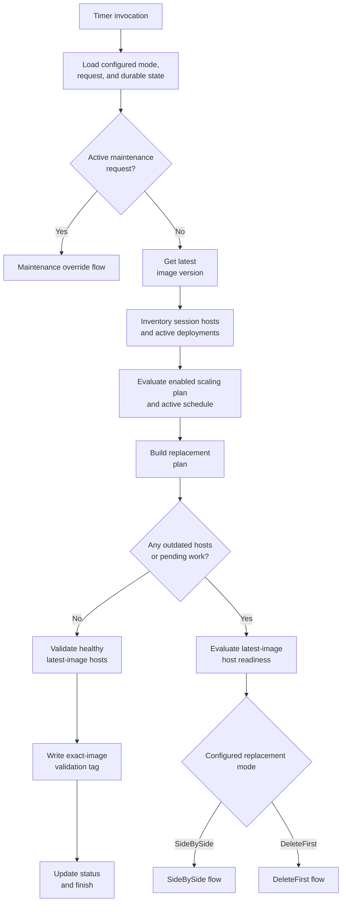
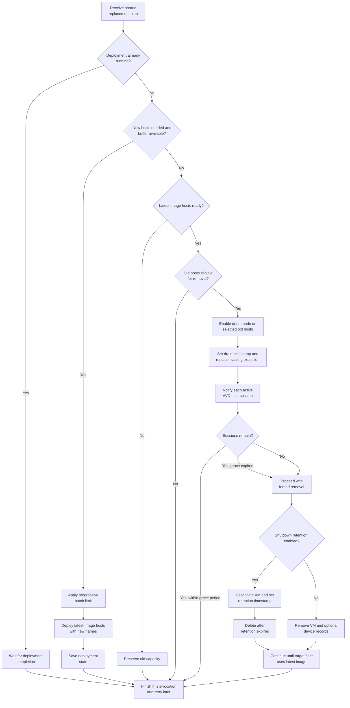
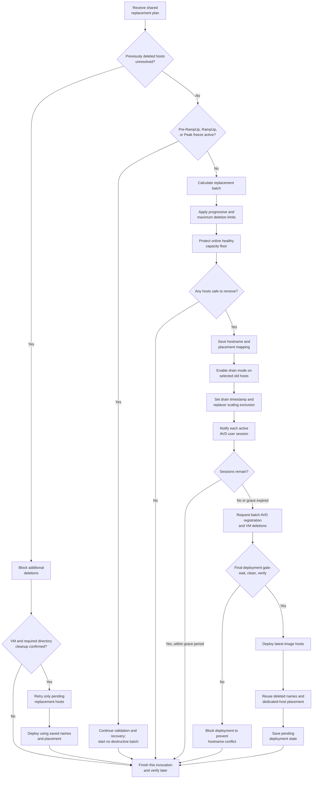
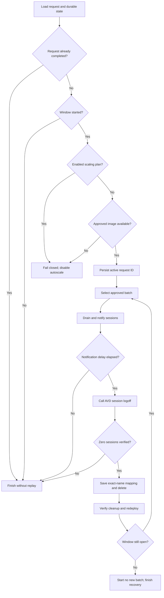

[**Home**](../../../README.md) | [**Session Host Replacer**](README.md) | [**Add-Ons**](../../../docs/add-ons.md)

# Canonical Session Host Replacer Flow

These diagrams describe one timer invocation. A replacement cycle can span multiple invocations while deployments complete, users drain, or safety checks block further work.

> **Canonical lifecycle reference:** This document owns the detailed replacement, readiness,
> scaling-phase, and recovery behavior. The [add-on README](README.md) owns deployment,
> configuration, monitoring, and troubleshooting guidance.

## Shared Evaluation

Normal replacement and the one-time maintenance override use the same inventory, image, planning,
and validation steps.

Exact-image evidence is written whenever a latest-image host has AVD status `Available` and no failed AVD health checks. Drain mode does not prevent evidence from being written.

Readiness then treats a latest-image host as either:

- Online ready: health validated and accepting new sessions.
- Scalable standby: exact-image evidence exists, the VM is stopped or deallocated, AVD status is `Shutdown`, no administrator scaling exclusion applies, and an enabled scaling plan can start it.

Without an enabled, evaluable scaling plan, all latest-image hosts must be online ready. With a scaling plan, every latest-image host must be either online ready or validated scalable standby, and at least one must be online ready even when the active target is `0%`.

## SideBySide

SideBySide creates replacement capacity before it removes old capacity. The pool can temporarily grow to twice its target size.

SideBySide-specific behavior:

- New hosts are deployed before old hosts are drained or removed.
- Replacement deployment, validation, and capacity-safe old-host removal can continue during every
  scaling phase. Before removal, the latest-image fleet must have the active scaling-plan percentage
  online, and the final fresh-state check preserves that online target.
- Failed readiness preserves the old hosts and waits for a later invocation.
- During an active `0%` scaling period, at least one latest-image host must remain online ready; the other validated latest-image hosts may be scalable standby.
- Shutdown retention is available only in this mode.
- Vacant names can be reused after out-of-band VM deletion. Required cleanup failures block the
  entire deployment batch and stop the invocation; old-host removal is not allowed to continue.
  The saved names are retried on subsequent scheduled runs.

## DeleteFirst

DeleteFirst removes a capacity-safe batch before deploying replacements. It records hostname and dedicated-host placement data before deletion so the replacement can reuse them.

DeleteFirst-specific behavior:

- The scaling plan remains enabled. Replacer-owned exclusion tags protect draining and newly deployed hosts while ordinary validated hosts remain available to autoscale.
- New destructive batches freeze 60 minutes before `RampUp` and throughout `RampUp` and `Peak`.
  Deployment recovery, registration checks, health validation, and release of validated hosts to
  autoscale continue.
- During `RampDown` and `OffPeak`, the active scaling-plan target controls replacement pace, but at least one online healthy host remains. Without an evaluable scaling plan, the configured percentage is used and capped at target minus one so pools of two or more can progress.
- Drained, unhealthy, unavailable, and scaled-down hosts do not authorize deletion of additional online healthy hosts. They remain eligible for replacement without consuming the online floor.
- An active `0%` scaling target still retains one online healthy host.
- OffPeak remains owned by the most recent selected schedule day until the next selected day's RampUp, including across midnight and unselected days.
- `MaxDeletionsPerCycle` remains an independent absolute blast-radius ceiling. Progressive scale-up may select a smaller batch, and the capacity floor may reduce it further.
- New deletions stop while a previously deleted host is not registered.
- Registration alone does not authorize another destructive batch; the replacement must pass exact-image, AVD availability, health, power-state, and session-acceptance checks.
- New deletions fail closed when the recovery state cannot be read or the pending-host mapping cannot be saved.
- Recovery can redeploy exact unresolved names after an externally caused or legacy empty-pool incident, but new cycles do not intentionally create one.
- VM and AVD registration deletion are revalidated before hostname reuse even when directory cleanup is disabled.
- Approved VM deletions are submitted before waiting, allowing Azure deletion operations to overlap.
  One final deployment gate waits for the batch, cleans required device records, and verifies all
  absences. Pending-name retries use the same gate without repeating per-host or outer verification.
- Only a definitive ARM `404` or `ResourceNotFound` confirms VM deletion; authorization, throttling, timeout, network, and service errors remain unresolved.
- Entra device cleanup is mandatory for Microsoft Entra joined hosts because DeleteFirst reuses the exact hostname. The function fails closed before destructive work if that required cleanup is disabled.
- Entra cleanup remains optional for domain-joined and Microsoft Entra hybrid joined hosts.
- Intune cleanup is mandatory for Intune-enrolled native Entra joined hosts. For enrolled AD DS
  hybrid-joined machines it remains optional and highly recommended.
- Enabled Entra ID or Intune cleanup is retried and revalidated before hostname reuse.
- A tracked or ARM-discovered running deployment blocks the invocation from deleting or deploying again.
- A deployment that remains `Running` fails closed until ARM or an operator moves it to a terminal state.
- A successful ARM deployment with pending AVD registration waits without cleanup or duplicate deployment.
- Accepted deployments require a durable tracking-state write; VM presence remains the duplicate-deployment gate if that write fails.
- Shutdown retention is always disabled.
- Exact-name DeleteFirst replacement is blocked for a single-host target because it cannot preserve one available host.

## One-Time Maintenance Override

The override is a one-time, administrator-armed maintenance operation on an existing DeleteFirst
replacer. `Start-SessionHostMaintenanceReplacement.ps1` writes a request containing a unique
request ID, exact approved image version, UTC start time, window duration, batch limit, notification
delay, forced-sign-out authorization, and optional full-pool-outage authorization. Continuous
DeleteFirst work is suspended while the request is scheduled or active and resumes after the
request completes or expires. While the request is scheduled, deployment monitoring and pending
recovery continue, but no new normal replacement batch starts.

Maintenance-override behavior:

- Durable request IDs prevent replay.
- The exact approved image version is pinned into replacement deployment parameters.
- Autoscale must be disabled. Failure to query scaling-plan state also fails closed.
- The function explicitly calls the AVD user-session logoff operation and re-queries sessions;
  deleting a VM does not substitute for logoff.
- Notification delay is evaluated on timer invocations. With the default 30-minute timer, forced
  sign-out can begin up to approximately 30 minutes after the requested delay elapses.
- A full-pool outage, including one-host replacement, requires explicit authorization.
- The configured replacement mode must be DeleteFirst.
- Any shutdown-retention VM blocks scheduling and execution; maintenance does not purge retained
  rollback capacity implicitly.
- When the window closes, no new destructive batch starts. Already draining or deleted hosts
  continue through exact-name recovery.
- A new override cannot activate while normal replacement has pending deletion recovery or a
  replacer-owned draining host.
- Shutdown retention is unavailable; use SideBySide when retained-host rollback is required.

## Cross-Cutting Batch Progression

When progressive scale-up is enabled, both modes begin with the configured percentage of the hosts
still needed. After the configured number of successful deployment and registration runs, the
percentage increases by the configured increment, up to 100%.

- A new image version resets progression to the initial percentage.
- ARM deployment success without AVD registration is not a successful run.
- A failed deployment resets progression.
- `MaxDeploymentBatchSize` caps SideBySide deployments.
- `MaxDeletionsPerCycle` caps DeleteFirst deletion and matching replacement deployment.
- Readiness, scaling-phase freezes, and the final fresh-state capacity check can reduce or defer a
  calculated batch.

## Durable Recovery State

Every mode saves selected deployment names and exact VM resource IDs in `PendingHostMappings`
before cleanup or ARM deployment. DeleteFirst also checkpoints hostname and placement information
before deleting a host. Ghost registrations whose VMs are definitively absent are checkpointed
before planning; a ghost does not count as a registered replacement.

The mapping remains until the replacement is deployed and registered:

1. A state read or durable pre-deletion write failure blocks deletion.
2. A failed or interrupted deployment leaves the mapping in place.
3. The next invocation blocks new deletion and retries only unresolved names.
4. Partial registration retries only names that remain unresolved.
5. A successful ARM deployment waits for AVD registration without deleting or redeploying it.
6. Only a registration with the expected live VM resolves a pending name; a ghost registration or
   a conflicting VM resource ID never does.

The stored positive auto-detected target remains authoritative during the cycle. Unresolved pending
names count toward target reconstruction, and an empty pool cannot establish a new zero target.

## Safe Name Reuse in Every Mode

The safety gate belongs to `Deploy-SessionHosts`, not only the DeleteFirst branch: SideBySide gap
allocation can also choose the name of a VM deleted outside the replacer. The planner does not
delete ghost registrations or directory records.

Before submitting any batch, the shared gate:

1. Resolves exact VM IDs with `virtualMachineNameConv`. Every selected VM must be absent before
   any identity or AVD registration is removed. A live, unregistered VM blocks the entire batch.
2. Requires authoritative ARM `404` or `ResourceNotFound`. Null responses, permission failures,
   throttling, and unknown errors do not establish absence.
3. Removes stale same-name Entra records for native Entra joined hosts and Intune records when
   those hosts use Intune enrollment, regardless of optional cleanup flags. AD DS and hybrid-joined
   machines honor the directory cleanup flags, but VM and AVD checks are always required.
   `EntraKerberos-Hybrid` means a **native Entra joined machine with hybrid user identities**; it
   is not an AD DS hybrid-joined machine.
4. Removes stale AVD registrations only when their resource ID matches the absent VM. A conflicting
   VM reference blocks cleanup. All Graph result pages are checked; multiple exact-name device
   matches are ambiguous and require operator review rather than bulk deletion.
5. Polls VM, AVD, and required directory absence, checks every requested host was verified, and
   freshly rechecks the exact VM IDs before the deployment PUT.

Only deletions requested by the current invocation enable the batch VM-deletion wait. A live VM
found during ordinary name allocation or a pending-name retry blocks immediately rather than
having its identities removed. SideBySide retirement and expired shutdown-VM cleanup likewise
submit their deletion requests before completing one shared batch cleanup gate; standalone VM
removal still waits for and verifies cleanup before returning. When a retained VM has no AVD
registration, its actual `osProfile.computerName`, not its potentially prefixed ARM resource name,
identifies directory records. An unavailable computer name blocks cleanup.

Each wait checks immediately; there is no unconditional sleep. VM-deletion and cleanup-verification
phases each use a default 10-minute polling budget with 30-second intervals when needed. API
request and retry time can extend elapsed duration. The final gate is never skipped because a
caller claims earlier cleanup succeeded. An already acquired Graph token is reused when available.

Missing Graph permissions or tokens, invalid API responses, ambiguous device records, incomplete
deletion, and failed recovery-state writes block the batch. No partial subset is deployed and the
invocation does not continue deleting other hosts. Pending name recovery retries at the next
scheduled invocation after the underlying condition is corrected. DeleteFirst starts no additional
destructive batch while its recovery remains unresolved. If a VM still exists after an interrupted
delete or deployment, the gate will not delete its identity to force reuse: inspect the VM and
complete approved resource cleanup first.

Failed-deployment cleanup uses exact VM IDs, never substring matching. New VMs carry
`AutoReplaceDeploymentName`; cleanup requires matching ownership, rechecks the current VM and
instance, and confirms VM deletion before removing identities. Failed cleanup preserves ARM
deployment history. **Upgrade note:** legacy failed hosts without durable VM IDs/ownership
inventory, or existing failed VMs without this ownership tag, require manual inspection and cleanup;
do not add a tag merely to bypass the ownership check.

Use an explicit positive `TargetSessionHostCount` when automatic replenishment must be guaranteed.
If an administrator deletes both a VM and its registration before a desired target or pending name
was saved, auto-detection cannot reconstruct the lost capacity. A stale directory record alone does
not identify how many VMs the pool should contain.
With a known target or pending mapping, DeleteFirst can refill that vacant slot through the same
mandatory device-cleanup gate without deleting another surviving host merely to replace the
missing capacity. Failure to clean the stale records blocks deployment and retries on a later run.

Run only one replacer for a pool and coordinate out-of-band provisioning. These checks reduce
name-reuse races but are not a distributed lock or an atomic transaction across ARM, AVD, and Graph.
Use a pool-specific hostname prefix unique across the tenant: directory cleanup uses exact device
names, and a single name match alone cannot prove ownership of an unrelated device in another pool.
Validate native Entra/Intune recovery and extension/AVD registration in an isolated live deployment;
offline tests cannot prove service-side replication timing or successful provisioning.

## Drain Notification

The user message is sent when the replacer first puts a selected host into drain mode, not when the host merely appears in a plan. Every active AVD session found on that host receives the configured maintenance message. A host already in drain mode with a drain timestamp is not notified again on every timer invocation.
