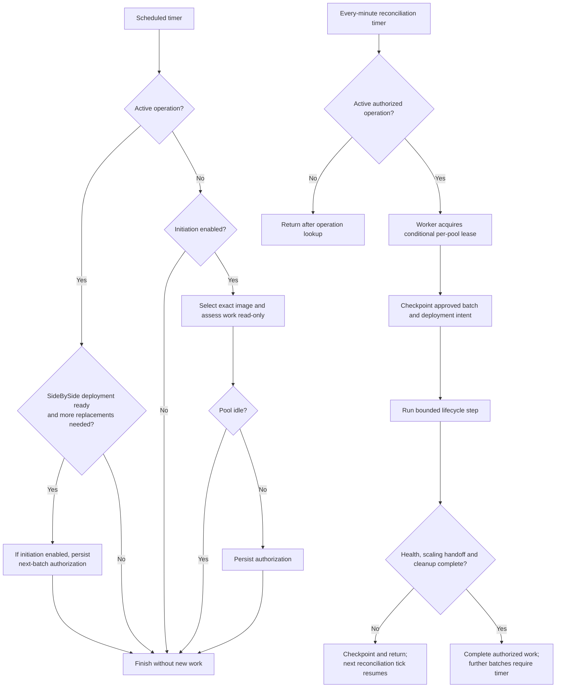
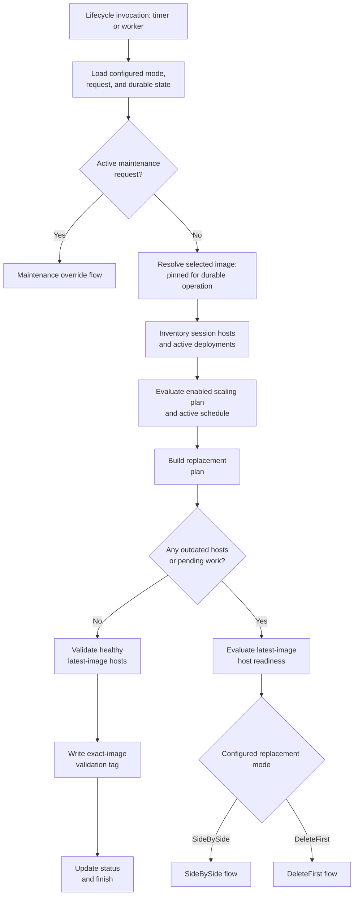
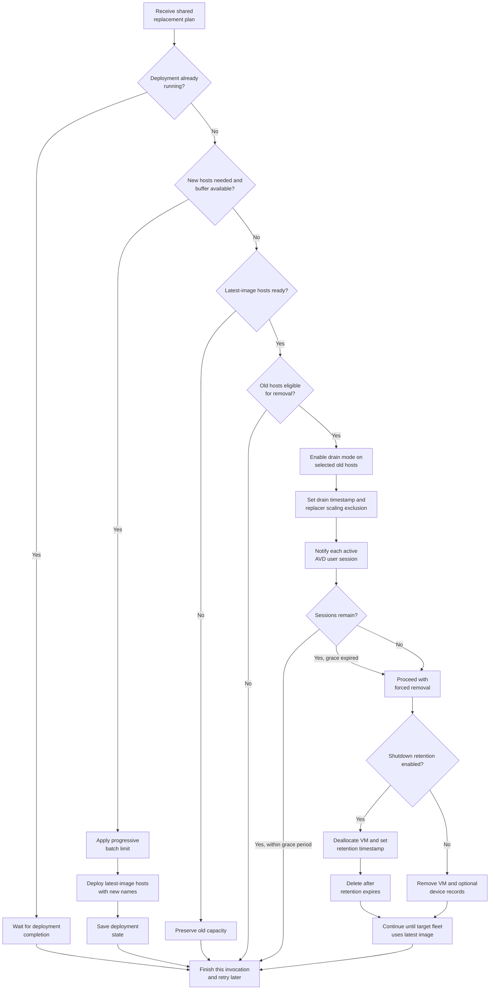
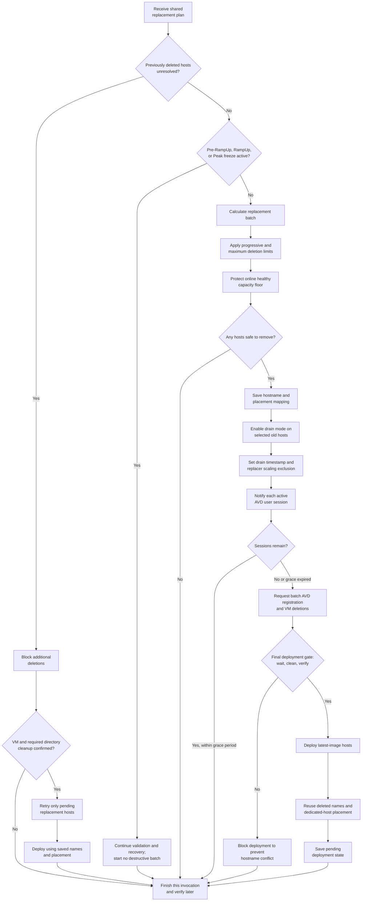
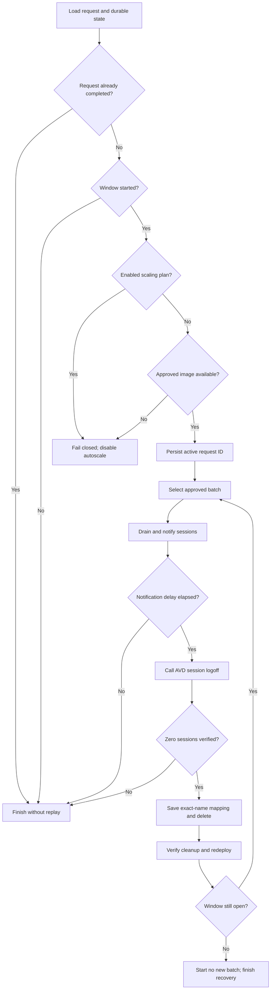

[**Home**](../../../README.md) | [**Session Host Replacer**](README.md) | [**Add-Ons**](../../../docs/add-ons.md)

# Canonical Session Host Replacer Flow

These diagrams describe one lifecycle-engine invocation. The initiation timer authorizes deployment
batches; a separate one-minute reconciliation timer progresses their deployment and retirement.
There is one shared lifecycle engine and no alternate execution mode.
A SideBySide operation can contain multiple scheduled
deployment batches while previously selected old hosts continue draining.

> **Canonical lifecycle reference:** This document owns the detailed replacement, readiness,
> scaling-phase, and recovery behavior. The [add-on README](README.md) owns deployment,
> configuration, monitoring, and troubleshooting guidance.

## Two-Timer Execution

Initiation is always separate from progress. Both functions run in the
same Function App; there is no additional VM or Function App.

The timer selects the image using the existing replication, exclusion, rollback and publication-age
policies; age is enforced again by planning. The worker does not switch to a newer publication.
Initial authorization expires after five minutes if no batch checkpoint has been established.
This prevents a delayed initiation from starting a replacement hours later. Once a batch has
started, its progress is independent of the initiation schedule.

With no active operation, the timer uses the shared replacement planner and readiness checks in
read-only mode before persisting authorization. An idle, healthy pool creates no operation.
The reconciliation timer still fires, but returns after its operation lookup without running the engine.
The initiation preflight still requires Azure
inventory, deployment, image and readiness reads; it is not an image-version-only cache.
Active operations always bypass this idle check and retain their existing progress/recovery path.

Capacity differences, image-policy work, unhealthy or draining hosts, recovery mappings, deployment
tracking, missing validation evidence and SHR-owned scaling exclusions require worker processing.
Maintenance requests and any shutdown-retention tags conservatively use the worker, including
unregistered retained VMs, so cleanup and tag/power-state repair cannot be skipped.
Configured host-tag repairs also require the worker. Read failures surface as errors, not an idle
result. The worker refreshes inventory and rechecks every lifecycle guard; the preflight does not
authorize mutations or relax readiness, including the active-scaling-plan requirement for standby.

The first worker step checkpoints the selected old-host names, deployment ceiling and pool target.
Subsequent planning uses the full inventory for capacity safety but restricts retirement to the
authorized names. Unselected old hosts require a later timer-authorized batch; metrics still report
the fleet's outstanding replacements. Existing drain/session timing, scaling-phase restrictions,
fresh-state deletion checks, exact-name recovery and shutdown retention remain in force.
Maintenance requests are not marked complete merely because one of their batches has finished.

### SideBySide deployment and retirement are separate gates

SideBySide does not wait for an earlier batch's old hosts to finish draining before permitting the
next scheduled deployment batch. Once all checkpointed replacement names are registered on the
pinned image, latest-image readiness passes, ARM work has finished, and SHR-owned scaling exclusions
have been released, a later initiation tick may authorize another deployment batch. The worker
rechecks readiness, registration, handoff, capacity and the authorization's five-minute expiry before
extending the scope. It cannot authorize itself or roll into another batch merely because it woke up.

The same leased operation retains the cumulative old-host names and continues their safe retirement
between ticks. Each additional deployment gets a distinct checkpointed intent. A pending cleanup
checkpoint or failed/unhealthy deployment blocks advancement; a long drain/session wait alone does
not. The image, pool target and operation deadline remain fixed across those batches. DeleteFirst
still requires the current delete/redeploy/health/handoff batch to finish before another starts.

For example, with a target of 20 and `maxDeploymentBatchSize=10`, the first 10 replacements can become
healthy while 10 old hosts remain occupied. The next eligible initiation tick can deploy the other
10 replacements without waiting for the old hosts' 24-hour grace period. Up to 40 VMs can temporarily
exist. This is not a completion-time guarantee: health, schedule, quota, subnet space, cleanup,
capacity and session gates still apply. The SideBySide deployment ceiling applies with or without
progressive batching; the planner retains its twice-target temporary-capacity ceiling.

### Live gallery replica safeguard

Before replacement planning, the worker reads the selected **exact image version** with
`$expand=ReplicationStatus` from Azure Resource Manager. This happens on every planning pass,
including continuation passes and later scheduled batches; the image stays pinned, but its
replica capacity is not cached. In-progress deployments are observed without starting another batch.

For the session-host region, the ceiling is **20 VMs per configured replica**. The regional
`regionalReplicaCount` overrides the version-wide `replicaCount`; counts from other regions are
never added. This follows [Microsoft's replica-sizing recommendation](https://learn.microsoft.com/azure/virtual-machines/azure-compute-gallery#scaling),
not a guaranteed Azure concurrency limit. The publishing profile and regional replication status
come from the [gallery image version GET API](https://learn.microsoft.com/rest/api/compute/gallery-image-versions/get).
Configured replicas are not a live count of free deployment slots. Other pools and deployments
can use the same image, so this is a per-pool safeguard, not a cross-pool reservation.

The planner applies this ceiling after existing mode-specific limits and progressive scale-up,
before selecting destructive replacement candidates. It cannot increase a smaller existing
allowance. DeleteFirst pending-host recovery and the final submission path also honor the
ceiling. A saved deployment retry that still exceeds it stops rather than silently splitting
the durable request; restore replica capacity and use the normal operation-recovery procedure.
An already accepted deployment is not canceled or resized.

Failed queries, missing/invalid counts, missing regional data or replication other than
`Completed` block new replacement planning and log an Error; later reconciliation can retry the
read. Full replication is required: shallow replication is deliberately blocked rather than
assuming that its single source can support full-replica concurrency. Marketplace images have
no customer-controlled gallery replicas and retain their existing batch behavior.

Information-level `IMAGE_REPLICA_CAP` logs record the exact image, region, effective count,
count source, replication status and ceiling. `IMAGE_REPLICA_BATCH` records the existing policy
allowance and resulting planned batch; `IMAGE_REPLICA_SUBMISSION` records the final submission
count, including retries. No new app setting or additional role assignment is required.

### Coordination and Recovery Boundaries

- The `shrContinuation` table stores one operation entity per fully qualified host pool, separate from
  the existing `sessionHostDeploymentState` recovery table. A companion `<pool-key>-initiation`
  entity holds the latest scheduled SideBySide authorization, scoped to operation ID and deployment
  batch number. It does not update the leased operation's ETag or grant a second worker ownership.
  Expired, consumed and superseded authorizations cannot extend the operation. Holding initiation
  also prevents consumption of unstarted authorizations. State updates use the returned ETag, never
  wildcard replacement. Deploy only one SHR Function App per pool; separate storage accounts cannot
  coordinate ownership.
- Reconciliation ticks resume the same operation without creating a new image or batch authorization.
  The worker acquires a
  30-minute lease using a conditional entity update. Mutating ARM/Graph calls and recovery-state
  writes check ownership and deadlines. Deadline checks run both before and after the ownership
  read, and Graph endpoint fallback and recovery-state writes recheck immediately before mutation.
  The host timeout is ten minutes; the engine yields before
  further mutations at its eight-minute budget. A crash can delay recovery until lease expiry.
- Retirement is checkpointed with exact computer names and VM resource IDs before unregistering
  an AVD host or submitting its VM deletion. Cleanup checkpoints retain the authorized VM deletions,
  deletion waits and directory-removal flags. On reconciliation, the worker resubmits an outstanding
  retirement deletion only when the exact VM still exists and is not already deleting; an already
  absent VM is not deleted again. It then performs one verification pass without a polling sleep,
  then yields if deletion is still pending. The next reconciliation tick replays that cleanup before
  inventory/planning, even when a deleted VM has disappeared from inventory. Names remain
  blocked until VM, registration and required directory absence is verified. Initial batch
  authorization is not extended by completing previously authorized cleanup.
- The minute timer supplies the next wake-up; no message, generation advancement or watchdog is
  required before side effects. The operation lease and intent are persisted before mutations.
  No operation, `Completed` and `Superseded` return without running the engine; `NeedsAttention`
  remains stopped. Transient state-read/acquisition failures are retried on a later tick.
  Different timer functions can overlap, so the shared ETag lease and companion authorization row
  remain necessary. The same timer does not run overlapping invocations across scaled instances.
  Polling, platform restarts and leases mean the cadence is not a completion-time guarantee.
- The deployment intent is saved before ARM submission. Its deterministic `shr_<operation-id>`
  name, exact hostnames, Template Spec version and request body are reused after an interruption.
  Later SideBySide batches use `shr_<operation-id>_bN`, retaining the original deployment history.
  An already accepted deployment is observed rather than submitted under a new name.
  Deployment inventory reads the current intent's exact ARM resource before planning or batch
  advancement, even if a crash prevented saving `LastDeploymentName` or the deployment is absent
  from the resource-group list. Legacy pool-prefix discovery remains; other pools' `shr_*`
  deployments are not included. Unreadable or invalid deployment status blocks the cycle.
  After partial failure, a checkpointed `_rN` retry includes only unresolved names and their aligned
  per-host placement settings; already registered hosts are not redeployed.
  Pending host mappings preserve planner priority through checkpoint serialization and reload;
  placement remains keyed by exact hostname. Invalid ARM deployment collection envelopes fail
  closed rather than being interpreted as an empty deployment list.
- The deadline is established once (`continuationTimeoutHours`, default 72, range 1-720); new
  reconciliation ticks and additional SideBySide batches do not reset it. Unexpected failures, changed initiating configuration and expired
  deadlines stop in `NeedsAttention`, retaining the batch, pins and recovery information.
  At an enabled initiation tick, a rejected first SideBySide submission can be automatically
  superseded after a template-only correction. The timer proves the protected settings otherwise
  match, the lease expired, the unchanged original template could not accept the saved parameters,
  ARM recorded no work, the targets do not exist, and old batch hosts
  remain healthy/accepting with no drain, retention or handoff work. Only exact matching prepared
  name reservations can remain; no mappings are cleared. Unknown state and failed reads block it.
  The complete failed operation is archived at `<pool-key>-superseded-<operation-id>` before an
  ETag-conditional transition to `Superseded`. A fresh timer-authorized operation selects its own
  image/deadline and records the superseded ID. `Superseded` is terminal for reconciliation;
  archive conflicts, timer races and crashes do not bypass ownership. See
  [automatic recovery](README.md#automatic-recovery-of-a-rejected-template-submission).
  See the [preview-first recovery command](README.md#recover-a-stopped-operation).
  Explicit recovery preserves the operation and its pins. Its only supported configuration rebase is an
  explicit template-reference repair for a rejected first SideBySide submission, with no deployment
  record or target VM/registration and a fingerprint proving no other protected setting changed.
  Active deployments, live leases and pending cleanup cannot be bypassed by the command.
- Operation state contains deployment parameters. Protect Table data access as carefully as
  Function App configuration; do not copy entity contents into public diagnostics. Oversized
  checkpoints fail explicitly. Reduce batch size rather than discarding state.

## Shared Evaluation

Normal replacement and the one-time maintenance override use the same inventory, image, planning,
and validation steps.

Exact-image evidence is written whenever a latest-image host has AVD status `Available` and no failed AVD health checks. Drain mode does not prevent evidence from being written.

Every scaling-exclusion cleanup path additionally requires an online, non-draining, automation-enabled
host on the exact image with the matching validation token. Shutdown-retention hosts and
administrator-owned exclusions are preserved. A cached token alone never authorizes release of an
unhealthy host. With an evaluable scaling plan, healthy hosts can be handed back individually while
other hosts are still warming up; old-capacity removal still waits for the full readiness gate.
Hosts in shutdown retention are excluded from active replacement-host readiness even when they use
the same image; retention expiration is not a prerequisite for completing a healthy replacement batch.
SHR releases its per-VM exclusion tag, not the scaling plan itself. AVD infrastructure health is not
proof that customer applications or the image's functional acceptance tests passed.

Readiness then treats a latest-image host as either:

- Online ready: health validated and accepting new sessions.
- Scalable standby: exact-image evidence exists, the VM is stopped or deallocated, AVD status is `Shutdown`, no administrator scaling exclusion applies, and an enabled scaling plan can start it.

Without an enabled, evaluable scaling plan, all latest-image hosts must be online ready. With a scaling plan, every latest-image host must be either online ready or validated scalable standby, and at least one must be online ready even when the active target is `0%`.

## SideBySide

SideBySide creates replacement capacity before it removes old capacity. The pool can temporarily grow to twice its target size.

SideBySide-specific behavior:

- New hosts are deployed before old hosts are drained or removed.
- Replacement deployment, validation, and capacity-safe old-host removal can continue during every
  scaling phase. Before removal, the latest-image fleet must have the active scaling-plan percentage
  online, and the final fresh-state check preserves that online target.
- Failed readiness preserves the old hosts and waits for a later invocation.
- During an active `0%` scaling period, at least one latest-image host must remain online ready; the other validated latest-image hosts may be scalable standby.
- Shutdown retention is available only in this mode.
- Vacant names can be reused after out-of-band VM deletion. Required cleanup failures block the
  entire deployment batch and stop the invocation; old-host removal is not allowed to continue.
  The saved names are retried on subsequent scheduled runs.

## DeleteFirst

DeleteFirst removes a capacity-safe batch before deploying replacements. It records hostname and dedicated-host placement data before deletion so the replacement can reuse them.

DeleteFirst-specific behavior:

- The scaling plan remains enabled. Replacer-owned exclusion tags protect draining and newly deployed hosts while ordinary validated hosts remain available to autoscale.
- New destructive batches freeze 60 minutes before `RampUp` and throughout `RampUp` and `Peak`.
  Deployment recovery, registration checks, health validation, and release of validated hosts to
  autoscale continue.
- During `RampDown` and `OffPeak`, the active scaling-plan target controls replacement pace, but at least one online healthy host remains. Without an evaluable scaling plan, the configured percentage is used and capped at target minus one so pools of two or more can progress.
- Drained, unhealthy, unavailable, and scaled-down hosts do not authorize deletion of additional online healthy hosts. They remain eligible for replacement without consuming the online floor.
- An active `0%` scaling target still retains one online healthy host.
- OffPeak remains owned by the most recent selected schedule day until the next selected day's RampUp, including across midnight and unselected days.
- `MaxDeletionsPerCycle` remains an independent absolute blast-radius ceiling. Progressive scale-up may select a smaller batch, and the capacity floor may reduce it further.
- New deletions stop while a previously deleted host is not registered.
- Registration alone does not authorize another destructive batch; the replacement must pass exact-image, AVD availability, health, power-state, and session-acceptance checks.
- New deletions fail closed when the recovery state cannot be read or the pending-host mapping cannot be saved.
- Recovery can redeploy exact unresolved names after an externally caused empty-pool incident, but replacement cycles do not intentionally create one.
- VM and AVD registration deletion are revalidated before hostname reuse even when directory cleanup is disabled.
- Approved VM deletions are submitted before waiting, allowing Azure deletion operations to overlap.
  One final deployment gate waits for the batch, cleans required device records, and verifies all
  absences. Pending-name retries use the same gate without repeating per-host or outer verification.
- Only a definitive ARM `404` or `ResourceNotFound` confirms VM deletion; authorization, throttling, timeout, network, and service errors remain unresolved.
- Entra device cleanup is mandatory for Microsoft Entra joined hosts because DeleteFirst reuses the exact hostname. The function fails closed before destructive work if that required cleanup is disabled.
- Entra cleanup remains optional for domain-joined and Microsoft Entra hybrid joined hosts.
- Intune cleanup is mandatory for Intune-enrolled native Entra joined hosts. For enrolled AD DS
  hybrid-joined machines it remains optional and highly recommended.
- Enabled Entra ID or Intune cleanup is retried and revalidated before hostname reuse.
- A tracked or ARM-discovered running deployment blocks the invocation from deleting or deploying again.
- A deployment that remains `Running` fails closed until ARM or an operator moves it to a terminal state.
- A successful ARM deployment with pending AVD registration waits without cleanup or duplicate deployment.
- Accepted deployments require a durable tracking-state write; VM presence remains the duplicate-deployment gate if that write fails.
- Shutdown retention is always disabled.
- Exact-name DeleteFirst replacement is blocked for a single-host target because it cannot preserve one available host.

## One-Time Maintenance Override

The override is a one-time, administrator-armed maintenance operation on an existing DeleteFirst
replacer. `Start-SessionHostMaintenanceReplacement.ps1` writes a request containing a unique
request ID, exact approved image version, UTC start time, window duration, batch limit, notification
delay, forced-sign-out authorization, and optional full-pool-outage authorization. Continuous
DeleteFirst work is suspended while the request is scheduled or active and resumes after the
request completes or expires. While the request is scheduled, deployment monitoring and pending
recovery continue, but no new normal replacement batch starts.

Maintenance-override behavior:

- Durable request IDs prevent replay.
- The exact approved image version is pinned into replacement deployment parameters.
- Autoscale must be disabled. Failure to query scaling-plan state also fails closed.
- The function explicitly calls the AVD user-session logoff operation and re-queries sessions;
  deleting a VM does not substitute for logoff.
- Notification delay for an active batch is evaluated by the minute reconciler, independently of
  the initiation schedule. Running invocations, restarts and leases can delay checks; the cadence
  does not guarantee an exact sign-out time.
- A full-pool outage, including one-host replacement, requires explicit authorization.
- The configured replacement mode must be DeleteFirst.
- Any shutdown-retention VM blocks scheduling and execution; maintenance does not purge retained
  rollback capacity implicitly.
- When the window closes, no new destructive batch starts. Already draining or deleted hosts
  continue through exact-name recovery.
- A new override cannot activate while normal replacement has pending deletion recovery or a
  replacer-owned draining host.
- Shutdown retention is unavailable; use SideBySide when retained-host rollback is required.

## Cross-Cutting Batch Progression

When progressive scale-up is enabled, both modes begin with the configured percentage of the hosts
still needed. After the configured number of successful deployment and registration runs, the
percentage increases by the configured increment, up to 100%.

- A new image version resets progression to the initial percentage.
- ARM deployment success without AVD registration is not a successful run.
- A failed deployment resets progression.
- `MaxDeploymentBatchSize` caps SideBySide deployments.
- `MaxDeletionsPerCycle` caps DeleteFirst deletion and matching replacement deployment.
- Readiness, scaling-phase freezes, and the final fresh-state capacity check can reduce or defer a
  calculated batch.

## Durable Recovery State

Every mode saves selected deployment names and exact VM resource IDs in `PendingHostMappings`
before cleanup or ARM deployment. DeleteFirst also checkpoints hostname and placement information
before deleting a host. Ghost registrations whose VMs are definitively absent are checkpointed
before planning; a ghost does not count as a registered replacement.

The mapping remains until the replacement is deployed and registered:

1. A state read or durable pre-deletion write failure blocks deletion.
2. A failed or interrupted deployment leaves the mapping in place.
3. The next invocation blocks new deletion and retries only unresolved names.
4. Partial registration retries only names that remain unresolved.
5. A successful ARM deployment waits for AVD registration without deleting or redeploying it.
6. Only a registration with the expected live VM resolves a pending name; a ghost registration or
   a conflicting VM resource ID never does.

The stored positive auto-detected target remains authoritative during the cycle. Unresolved pending
names count toward target reconstruction, and an empty pool cannot establish a new zero target.

## Safe Name Reuse in Every Mode

The safety gate belongs to `Deploy-SessionHosts`, not only the DeleteFirst branch: SideBySide gap
allocation can also choose the name of a VM deleted outside the replacer. The planner does not
delete ghost registrations or directory records.

Before submitting any batch, the shared gate:

1. Resolves exact VM IDs with `virtualMachineNameConv` and performs read-only discovery: one AVD
   inventory read and one exact-name lookup per required directory for each selected hostname.
   Registration matching uses a case-insensitive name index, not a nested scan of the batch.
2. Requires authoritative ARM `404` or `ResourceNotFound` for every selected VM before any identity
   or AVD registration is removed. A live, unregistered VM blocks the entire batch. Null responses,
   permission failures, throttling, and unknown errors do not establish absence.
3. Plans stale same-name Entra cleanup for native Entra joined hosts and Intune cleanup when
   those hosts use Intune enrollment, regardless of optional cleanup flags. AD DS and hybrid-joined
   machines honor the directory cleanup flags, but VM and AVD checks are always required.
   `EntraKerberos-Hybrid` means a **native Entra joined machine with hybrid user identities**; it
   is not an AD DS hybrid-joined machine.
4. Removes discovered directory records and stale AVD registrations only after the whole batch
   passes discovery and VM-absence checks. A registration must reference the expected VM. All Graph
   result pages are checked; multiple exact-name devices require operator review, not bulk deletion.
5. Polls only the systems for which it requested deletion, and only until their absence is confirmed.
   Already-absent records are not polled again. VM checks are not repeated inside directory or AVD
   verification. Any cleanup or VM-deletion wait is followed by a fresh whole-batch VM check before
   the deployment PUT. A clean ordinary allocation ends with its single VM-absence check.

The observations used to skip redundant polling come from the current gate's own validated API
responses, never caller-supplied success flags or a previous run. A pending-name retry performs
fresh discovery. The standalone `Confirm-SessionHostDeletions` command retains full verification.

For `B` selected names, `D` required directories, and `P` pages in the AVD inventory, a clean
ordinary allocation uses `(D + 1) * B + P` reads. Already-clean names following a requested
VM deletion use `(D + 2) * B + P` reads when the VM wait completes on its first check. For 100
native Entra joined, Intune-enrolled names and a single AVD page, these are 301 and 401 reads,
respectively, rather than the previous 702. These counts exclude tokens, recovery-state access,
deletion requests, additional polling, pagination of directory results, and API retries. Stale
records require additional confirmation reads only for the affected systems.

Only deletions authorized by the current invocation or its durable retirement checkpoint enable
the batch VM-deletion wait. A live VM
found during ordinary name allocation or a pending-name retry blocks without a VM-deletion wait
or identity deletion. SideBySide retirement and expired shutdown-VM cleanup likewise
submit their deletion requests before completing one shared batch cleanup gate; standalone VM
removal still waits for and verifies cleanup before returning. When a retained VM has no AVD
registration, its actual `osProfile.computerName`, not its potentially prefixed ARM resource name,
identifies directory records. An unavailable computer name blocks cleanup.

Each wait checks immediately; there is no unconditional sleep. VM-deletion and cleanup-verification
phases each use a default 10-minute polling budget with 30-second intervals when needed. API
request and retry time can extend elapsed duration. The final gate is never skipped because a
caller claims earlier cleanup succeeded. An already acquired Graph token is reused when available.

Missing Graph permissions or tokens, invalid API responses, ambiguous device records, incomplete
deletion, and failed recovery-state writes block the batch. No partial subset is deployed and the
invocation does not continue deleting other hosts. Pending name recovery retries at the next
scheduled invocation after the underlying condition is corrected. DeleteFirst starts no additional
destructive batch while its recovery remains unresolved. If a VM still exists after an interrupted
delete or deployment, the gate will not delete its identity to force reuse: inspect the VM and
complete approved resource cleanup first.

Failed-deployment cleanup uses exact VM IDs, never substring matching. New VMs carry
`AutoReplaceDeploymentName`; cleanup requires matching ownership, rechecks the current VM and
instance, and confirms VM deletion before removing identities. Failed cleanup preserves ARM
deployment history. Failed hosts without durable VM IDs/ownership
inventory, or existing failed VMs without this ownership tag, require manual inspection and cleanup;
do not add a tag merely to bypass the ownership check.

Use an explicit positive `TargetSessionHostCount` when automatic replenishment must be guaranteed.
If an administrator deletes both a VM and its registration before a desired target or pending name
was saved, auto-detection cannot reconstruct the lost capacity. A stale directory record alone does
not identify how many VMs the pool should contain.
With a known target or pending mapping, DeleteFirst can refill that vacant slot through the same
mandatory device-cleanup gate without deleting another surviving host merely to replace the
missing capacity. Failure to clean the stale records blocks deployment and retries on a later run.

Run only one replacer for a pool and coordinate out-of-band provisioning. These checks reduce
name-reuse races but are not a distributed lock or an atomic transaction across ARM, AVD, and Graph.
Use a pool-specific hostname prefix unique across the tenant: directory cleanup uses exact device
names, and a single name match alone cannot prove ownership of an unrelated device in another pool.
Validate native Entra/Intune recovery and extension/AVD registration in an isolated live deployment;
offline tests cannot prove service-side replication timing or successful provisioning.

## Drain Notification

The user message is sent when the replacer first puts a selected host into drain mode, not when the host merely appears in a plan. Every active AVD session found on that host receives the configured maintenance message. A host already in drain mode with a drain timestamp is not notified again on every timer invocation.
