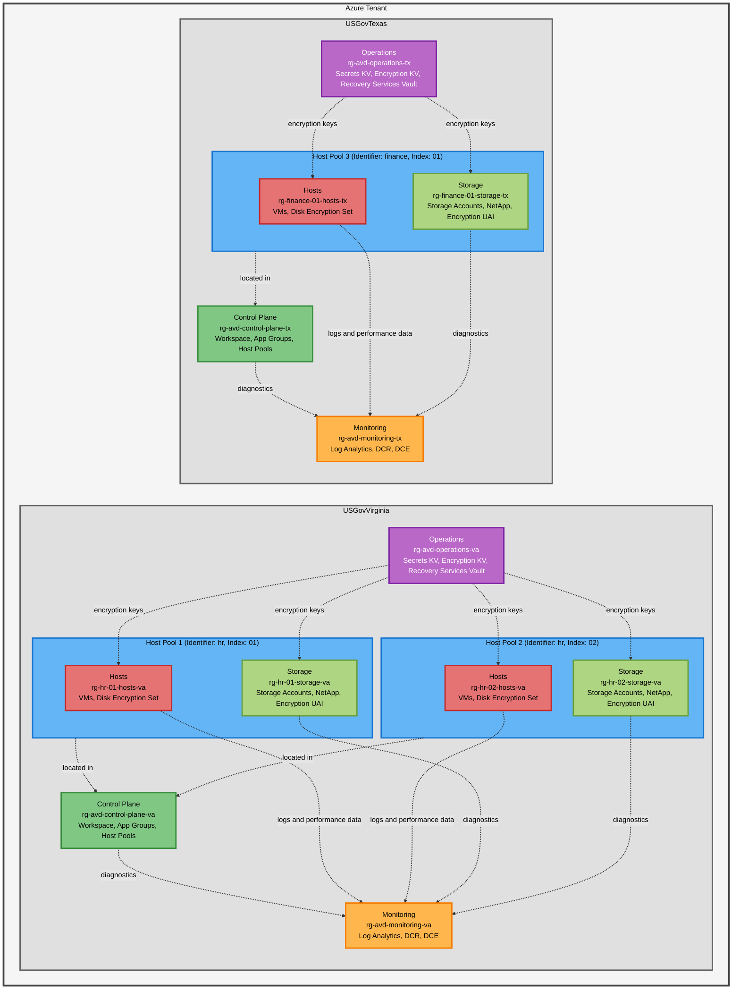

[**Home**](../README.md) | [**Quick Start**](quick-start.md) | [**Host Pool Deployment**](hostpool-deployment.md) | [**Image Build**](image-build.md) | [**Artifacts**](artifacts-guide.md) | [**Features**](features.md) | [**Parameters**](parameters.md) | [**Compliance**](compliance.md) | [**BCDR**](bcdr.md)

# Design

This Azure Virtual Desktop (AVD) solution will deploy fully operational AVD hostpool(s) to an Azure subscription.

This page describes the Azure resource topology. See [Secure Endpoint Architecture](secure-endpoint-architecture.md)
for the control-layer, shared-responsibility, lifecycle, evidence, and AI access model implemented
through that topology.

## Shared module contracts

Shared Bicep files under `deployments/shared/modules/` describe their purpose with
`metadata name` and `metadata description`. Parameter and output descriptions
document their input requirements, resource ownership, collection shapes, and
returned values. These descriptions are also emitted into compiled ARM templates.
A parameter without a default remains a required Bicep input even when its
associated feature is optional; pass an empty value only when its description
allows it. Descriptions do not replace type constraints or deployment validation.

- **Resource modules** deploy or update a resource and its closely related children.
  Their descriptions identify existing parent resources and other caller-owned
  dependencies. A resource-group-scoped module does not create its deployment
  resource group unless explicitly documented.
- **Orchestration modules** compose resources, cross-scope deployments, role
  assignments, and sequencing for a capability. Read their input contracts before
  invoking lower-level resource modules directly.
- **Type and function libraries** provide shared contracts or helpers rather than
  independently deploying a capability.

For capability-level composition, start with the orchestration entry points:

| Capability | Shared entry point |
| --- | --- |
| Workspace and application-group composition | [AVD workspace](../deployments/shared/modules/orchestration/avdWorkspace/avdWorkspace.bicep) |
| Customer-managed encryption dependencies | [Customer-managed keys](../deployments/shared/modules/orchestration/customerManagedKeys/customerManagedKeys.bicep) |
| Profile storage | [FSLogix](../deployments/shared/modules/orchestration/fslogix/fslogix.bicep) |
| Credentials and encryption vaults | [Key Vaults](../deployments/shared/modules/orchestration/keyVaults/keyVaults.bicep) |
| Host monitoring resources | [Monitoring](../deployments/shared/modules/orchestration/monitoring/monitoring.bicep) |
| Session host deployment | [Session hosts](../deployments/shared/modules/orchestration/sessionHosts/sessionHosts.bicep) |
| Session host policy internals | [Policy authoring contract](../deployments/shared/modules/orchestration/sessionHostPolicy/AUTHORING.md) |

Use the [shared naming contract](../deployments/shared/modules/orchestration/naming/README.md)
for generated names and the
[Function App composition contract](../deployments/shared/modules/resourceModules/functionApp/README.md)
for plan ownership, app infrastructure, and function-code deployment.

When adding a shared module, include its purpose, deployment scope, important
prerequisites, and descriptions for every parameter and output. Preserve these
contracts when changing a module. Prefer detailed explanations, examples, and
sequencing guidance in Bicep source comments, which are not transpiled into ARM.
Keep emitted module metadata and parameter/output descriptions concise while
retaining the information needed to use the interface correctly. Run
`Invoke-Pester -Script tests\ModuleMetadata.Tests.ps1` to compile all shared modules
and check their emitted metadata; Azure CLI and Bicep must already be installed.
No Azure sign-in or deployment is required. Rebuild affected tracked ARM templates
after changing descriptions, including nested templates embedded by policy modules.

### Generated-template size budgets

Check size after changing shared modules: their content can appear in multiple
nested deployments in the transpiled ARM. Microsoft documents an
[ARM template limit of 4 MB](https://learn.microsoft.com/en-us/azure/azure-resource-manager/templates/best-practices#template-limits)
and a separate [Template Spec content limit of approximately 2 MB](https://learn.microsoft.com/en-us/azure/azure-resource-manager/templates/template-specs).
The Template Spec budget must include the main template, attached Portal form,
any packaged linked templates, and publishing metadata/envelope.

`tools/New-TemplateSpecs.ps1` keeps the full documentation in Bicep source and
tracked ARM files. Only the temporary publication copy omits nested-template
parameter/output/type descriptions and Bicep compiler provenance. It retains
top-level interface descriptions (including linked-template entry points),
module names and summaries, other interface metadata and validation constraints,
resource/policy metadata, and the entire Portal form. Developers and Copilot
should use the repository sources to understand and reuse module contracts, not
reconstruct them from a published Template Spec.

The publisher uses the normal Az.Resources packaging engine to stage the filtered
copy, including linked artifacts, and still publishes with `New-AzTemplateSpec`.
It does not depend on input minification or change SDK serialization settings.
Before any resource creation or publication, every selected package is measured
using the installed Az.Resources SDK's normal version-request serializer, including
the main template, linked artifacts, Portal form, and location envelope. A
16,384-byte (16 KiB) safety margin reserves room for additional publishing metadata;
it is not data appended to the template. Output separates the measured request,
reserved margin, total checked, and remaining headroom against the 2,000,000-byte
budget. Staging files are removed on success or failure.

Run `Invoke-Pester -Script tests\TemplateSpecs.Tests.ps1,tests\HostPoolOrchestratorSize.Tests.ps1`
after changes affecting publication. These offline checks require Az.Resources,
cover all current template/form pairs, enforce the publication budget and a
4,000,000-byte tracked ARM file budget, and verify annotation filtering preserves
deployment content. They do not require Azure sign-in and do not prove service
acceptance. ARM also applies expanded-template and per-resource limits that raw
file measurements cannot prove.

## Naming and resource topology

The deployment utilizes the Cloud Adoption Framework naming conventions and organizes resources and resource groups in accordance with several available parameters:

- Persona Identifier (***identifier***): This parameter is used to uniquely identify the persona of the host pool(s). Each persona, or each group of users with distinct business functions and technical requirements, would require a specific host-pool configuration and thus we use the persona term to identify the host pool. For more information about personas see [User Personas | AVD Cloud Adoption Framework](https://learn.microsoft.com/en-us/azure/cloud-adoption-framework/scenarios/azure-virtual-desktop/migrate-assess#user-personas).

- Host Pool Index (***index***): This *optional* parameter is used when we must shard the unique persona across multiple host pools. For more information, see [Sharding Pattern](https://docs.microsoft.com/en-us/azure/architecture/patterns/sharding).

- Naming Convention (`namingConvention`): An optional object parameter that controls how every resource in the deployment is named. The default value produces CAF-aligned names (`resourceType-avd-purpose-location`). The `purpose` component is a FederalAVD addition with no direct CAF equivalent — it disambiguates resources of the same type within a deployment. When customized, the engine assembles names from an ordered array of components (resourceType, purpose, location, workload, environment, freeform1, freeform2). See the **[Naming Convention guide](naming-convention.md)** for the full parameter schema, examples, and cross-solution alignment.

The diagram below highlights how the resource groups are created based on the parameters.

The diagram illustrates the following resource group distribution. In the table below, the example names are utilizing the following parameter values:

- **identifier**: 'hr'
- **index**: '01', '02'
- locationVirtualMachines (determined by **virtualMachineSubnetResourceId** location): 'USGovVirginia'
- **locationControlPlane**: 'USGovVirginia'
- **namingConvention**: *(default — CAF convention)*

| Purpose | Resources | Example Name | Notes |
| ------- | :-------: | ------------ | ----- |
| Global Feed | global feed workspace | rg-avd-global-feed | One per Tenant |
| Monitoring | Log Analytics Workspace AVD Insights Data Collection Rule Data Collection Endpoint | rg-avd-monitoring-va | One per region |
| Operations | Secrets Key Vault Encryption Key Vault Recovery Services Vault (Azure Files backup, pooled host pools) | rg-avd-operations-va | One per region. AVD Shared Services owns the shared FSLogix vault and Azure Files backup policy. Host pools and standalone FSLogix storage deployments register their own shares as protected items. Inline host-pool creation remains a compatibility fallback. VM backup vaults for personal host pools remain per-host-pool resources in the Hosts resource group. |
| Control Plane | feed workspace application groups hostpools scaling plans | rg-avd-control-plane-va | One per region |
| Hosts | virtual machines disk encryption set Recovery Services Vault (VM backup, personal host pools only) | rg-hr-01-hosts-va rg-hr-02-hosts-va | One per identifier or per index (if specified). Disk Encryption Set is created here when CMK is used for VM disks. Recovery Services Vault for VM backup is deployed here when `recoveryServices = true` on a personal host pool — one vault per host pool, not shared. |
| Storage | NetApp Storage Accounts Storage Account(s) function app storage encryption UAI | rg-hr-01-storage-va rg-hr-02-storage-va | One per identifier or per index (if specified). Storage encryption User-Assigned Identity is created here when CMK is used for FSLogix storage. |

Standard and automated production host pools use the same regional Control Plane resource group
for all personas that share the control-plane subscription and naming convention. The persona
identifier distinguishes host pools, application groups, and scaling plans inside that group; it
does not appear in the group's purpose component. The dedicated PoC is the exception: its
resources remain in one persona-specific consolidated resource group.

When `existingFeedWorkspaceResourceId` is supplied, its resource group takes precedence over
the generated regional name. Both production deployments reuse that group without creating or
retagging it. Its subscription must match the target control-plane subscription: for standard
host pools, set `controlPlaneSubscriptionId` when it differs from the deployment subscription;
automated host pools use the deployment subscription. Keep the selected control-plane region
consistent with the workspace region.

> **Existing deployments using per-persona Control Plane resource groups:** Correcting the naming
> does not relocate existing resources. Plan migration before redeploying those pools with the
> corrected templates; a different resource group produces different resource IDs and can create
> a second pool instead of updating the existing one.

Because the Monitoring and Operations resource groups are shared across all host pools in a region, costs for Log Analytics, Recovery Services Vaults, and Key Vaults cannot be attributed per host pool through Azure Cost Management alone. See [Chargeback for Shared Resources](chargeback-shared-resources.md) for query-based approaches that use the `cm-resource-parent` tags stamped on keys, protected items, and VMs.

The code is idempotent, allowing you to scale storage and sessions hosts, but the core management resources will persist and update for any subsequent deployments. Some of those resources are the host pool, application group, and log analytics workspace.

Both a personal or pooled host pool can be deployed with this solution. Either option will deploy a desktop application group with a role assignment. You can also deploy the required resources and configurations to fully enable FSLogix. This solution also automates many of the [features](features.md) that are usually enabled manually after deploying an AVD host pool.

## Naming Convention Internals

> **Audience:** contributors extending or debugging the naming logic. Operators deploying the template only need the parameter descriptions and the table above. For the full naming reference, see [Naming Convention](naming-convention.md).

All resource names are assembled from an ordered array of **components** — named slots that the engine fills with resource-type abbreviations, location abbreviations, static labels, and per-resource differentiators. The active convention is controlled by the `namingConvention` parameter object.

### Key concepts

| Concept | Description |
| --- | --- |
| components array | Ordered list of component names (esourceType\, `purpose`, \location\, \workload\, \nvironment\, \reeform1\, \reeform2\, one\) |
| purpose | Per-resource differentiator (e.g., \vd-01\, \sec\, \control-plane\) — set automatically by the engine for each resource; no direct CAF equivalent |
| RT-first | esourceType\ is the first non-one\ component — produces \dpool-avd-use\ style names |
| RT-last | esourceType\ is the last non-one\ component — produces \vd-use-vdpool\ style names |

### CAF-aligned default

The default `namingConvention` value produces names following `{resourceType}-avd-{purpose}-{location}` via the same `cnv()` user-defined function used for all resources. This is CAF-aligned but not a strict CAF implementation: CAF does not define a `purpose` component.

### Custom naming path

The `cnv()` user-defined function maps each component name to its value, filters out empty values, and joins with the configured delimiter. The same function is called for every resource, with only the `purpose` argument varying per resource.

### Add-on convention inference

The three add-ons (Session Host Replacer, Session Hosts, Storage Quota Manager) infer the naming convention from the existing host pool name. They detect RT-last when the host pool name ends with -vdpool or -hp, and default to RT-first otherwise.

### Implementation location

The host-pool naming engine lives in [deployments/shared/modules/orchestration/naming/hostPool.bicep](../deployments/shared/modules/orchestration/naming/hostPool.bicep) and is shared by standard host pools, automated host pools, and standalone FSLogix storage. AVD Shared Services and Image Management use the same convention shape in their solution-specific naming logic.
