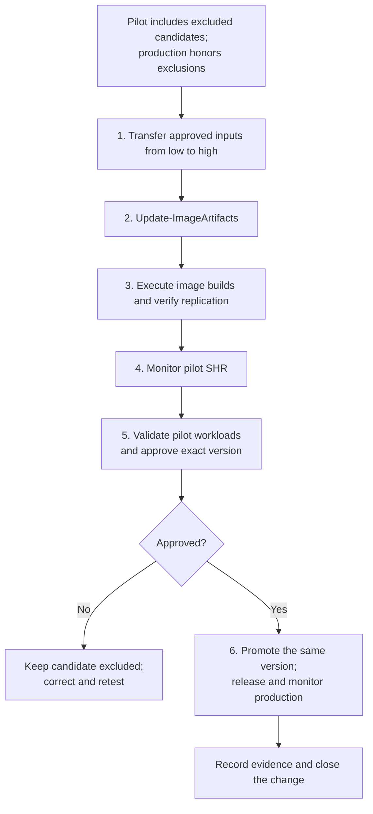
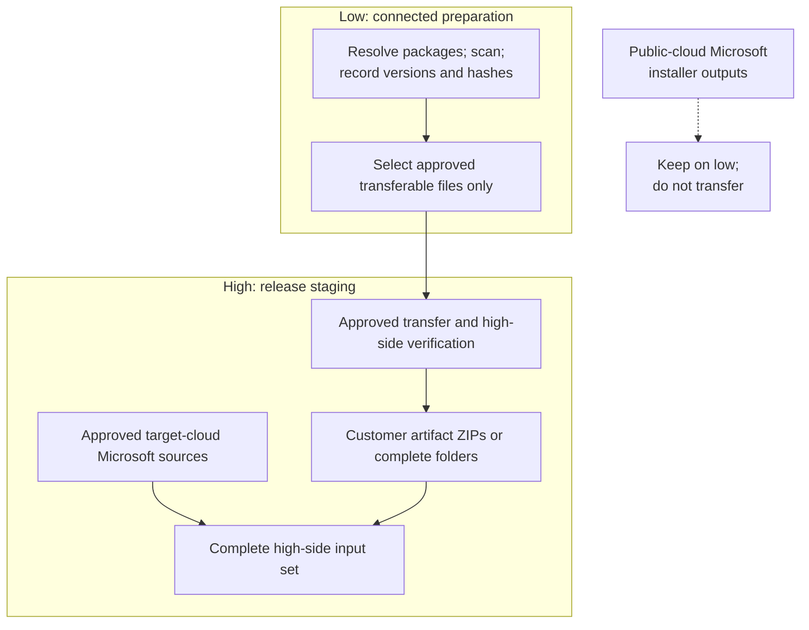
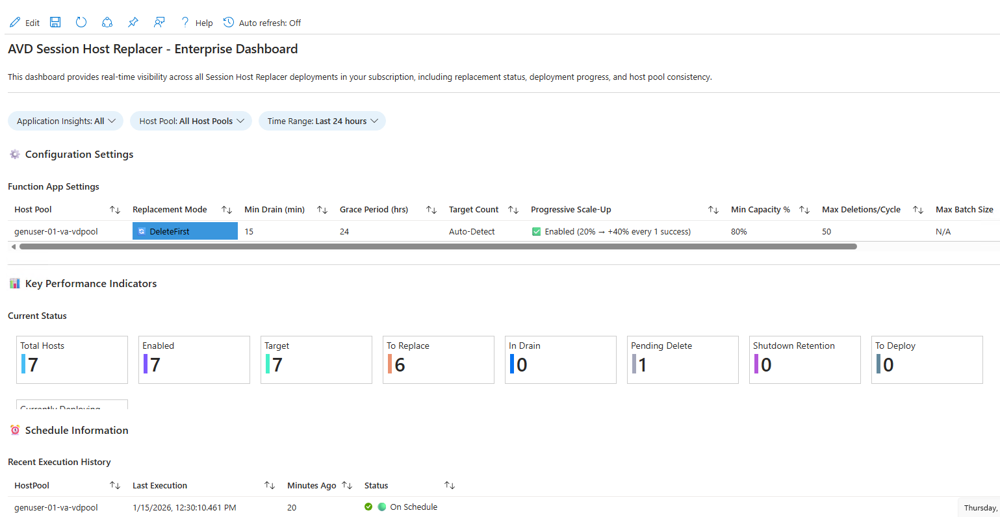
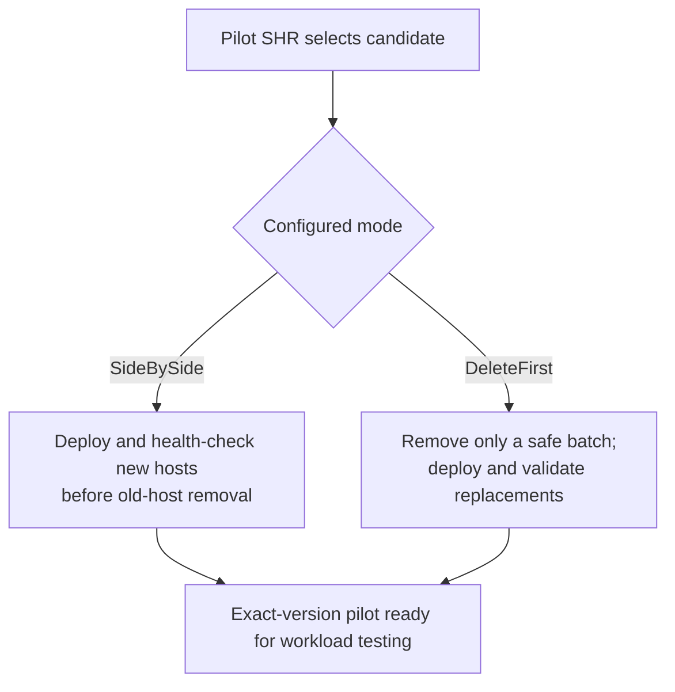
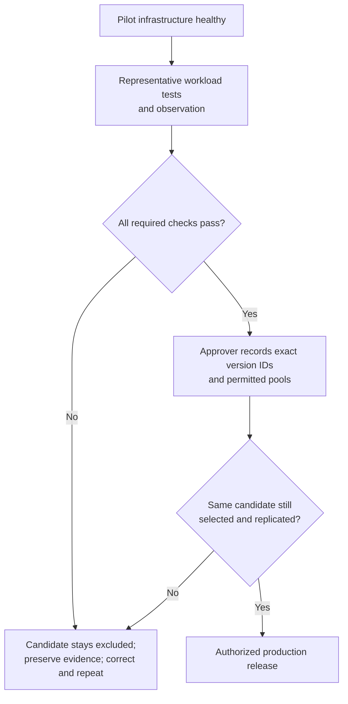
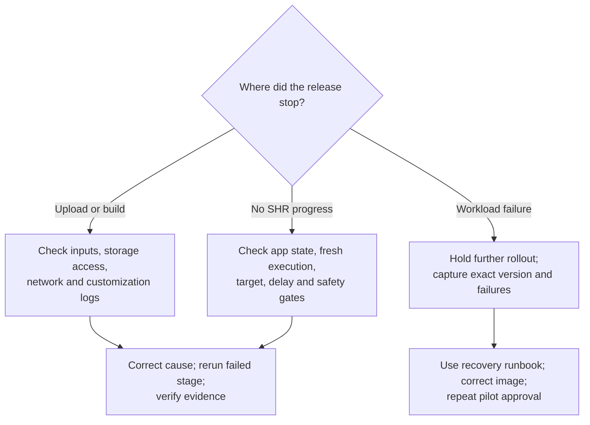

[**Home**](../README.md) | [**Documentation**](README.md) | [**Air-Gapped Clouds**](air-gapped-clouds.md) | [**Session Host Replacer**](session-host-replacer.md)

# Monthly Image Operations: Air-Gapped Operator's Guide

Use this runbook to refresh an **already deployed, image-managed standard host pool** in Azure
Government Secret or Top Secret. Image Management, Image Build, a dedicated pilot host pool,
production host pools, and one Session Host Replacer (SHR) Function App per pool already exist.
This is not a first-deployment guide or the Commercial-only automated host-pool workflow.

**Release rule:** Build once per image family, test that exact gallery version in the pilot, then
release it to production. Do not rebuild a separate, untested "production" version after approval.
Repeat the pilot tests for each distinct image family/persona and relevant regional configuration.



## Before the Monthly Window

### Prepare the change record

Record these values in the high-side change ticket; do not put credentials or secrets in it.

| Record | What to capture |
| --- | --- |
| Release | Change ID, operator, approver, maintenance window, pilot observation period, repository release/commit |
| Inputs | Approved transfer inventory, exact filenames, versions, SHA-256 hashes, signature/scanning approval, licenses, and destination paths |
| Build | Customer root, artifacts storage account resource ID, image-build parameter-file prefixes, deployment region |
| Each image family | Gallery image definition, pilot pool, consuming production pools, required replication regions, previous known-good version |
| Each SHR instance | Function App name/resource group/subscription, initial Running/Stopped state, replacement mode, schedule/time zone, drain and rollout settings |
| Release evidence | Build deployment IDs, exact candidate version resource IDs, pilot results, approval time, production completion or recovery actions |

Use representative pilot users and workloads. Match the production join method, applications,
FSLogix configuration, policies, security agents, and relevant network paths. A disposable PoC
with different settings is not a substitute. Agree on the observation period and acceptance
criteria before starting; do not invent a universal number of hours for every workload.

### Establish the pilot release gate before publication

**A rollout delay is not an approval gate.** With a shared image definition, a newly published
nonexcluded version can become eligible for every consuming SHR. Delay is based on image publication
time, not the time the operator approves it.

Use upgraded SHR code on both pilot and production, with gallery **definition** references:

- Pilot SHR: `includeExcludedImageVersions=true`.
- Every production SHR: `includeExcludedImageVersions=false` (default).
- Candidate Image Build parameters: `imageVersionExcludeFromLatest=true` **before the build**.
- After successful pilot validation: clear the exclusion on the **same version**, not a rebuild.

The pilot option ignores both global and regional exclusions but preserves replication, image-age
delay, rollback protection, health and capacity checks. Earlier SHR versions do not provide this
contract; upgrade and verify the selected numeric target before relying on it. Setting an environment
variable alone does not upgrade the Function App code. Persist the option in deployment parameters.
See [pilot configuration and promotion](../deployments/add-ons/sessionHostReplacer/README.md#pilot-image-selection-and-promotion).

**Choose the production release scope:** Clearing a global exclusion releases the candidate to every
eligible consumer. If the change permits this, production SHR can stay running while the candidate
is excluded. For this runbook's **one-pool-at-a-time** production release, also hold production:

1. Review the workbook for every production pool. Wait for active replacements, drain/delete work,
   deployments, and recovery work to settle. If an incident is in progress, use the recovery
   procedure rather than treating this as a normal monthly release.
2. Record each Function App's initial state. Stop the production SHR instances that are Running,
   **before starting the build**. Leave the pilot SHR available for the test cycle.
3. Confirm each deliberately held production Function App reaches **Stopped**. Keep the approved production hold
   in place until Step 6; coordinate with other operators so nobody restarts or redeploys it.
   Reserve the image definitions for this release so no competing publisher introduces a candidate
   during build, pilot validation, or production rollout.
   Recheck that no in-flight replacement work remains; Stopped alone does not prove it has settled.

From the authorized high-side PowerShell session, one production instance at a time:

```powershell
Stop-AzFunctionApp `
    -Name '<production-shr-name>' `
    -ResourceGroupName '<shr-resource-group>' `
    -SubscriptionId '<production-subscription-id>'

Get-AzFunctionApp `
    -Name '<production-shr-name>' `
    -ResourceGroupName '<shr-resource-group>' `
    -SubscriptionId '<production-subscription-id>' |
    Select-Object Name, State
```

Stopping SHR prevents further timer work; it does **not** cancel submitted ARM deployments,
reverse draining/deletion, stop autoscale, or restore old hosts. Do not start an instance later
just because this runbook mentions "resume" if it was already intentionally stopped.

### Confirm high-side readiness

- Connect using the enclave's authorized instructions in
  [Configure and Connect With Azure PowerShell](air-gapped-clouds.md#configure-and-connect-with-azure-powershell).
  Check the tenant, environment, and subscription before any write. Do not use Commercial defaults.
- Use an approved repository/tool release already staged on high. Monthly operations do not
  require republishing Template Specs or redeploying host pools unless infrastructure changes.
- Confirm management-workstation access to artifact storage and ARM, plus build/session-host access
  to their required private endpoints, DNS, identity, AVD, and approved content services.
- Verify existing host-pool `agentDownloadUrl` and `agentBootLoaderDownloadUrl` values/defaults
  resolve to valid target-cloud or internally hosted sources. See
  [session-host download behavior](air-gapped-clouds.md#session-host-deployment); staged image-build
  inputs alone do not prove replacement hosts can obtain and register their AVD agents.
- Confirm storage **data-plane** upload permissions, build permissions, SHR health, quota, subnet IPs,
  and the existing capacity/retention plan. SideBySide needs temporary extra VM capacity;
  DeleteFirst needs a safe capacity floor and a suitable scaling-plan phase.

Run subsequent high-side script examples from the **repository root**. Replace these placeholders
with your recorded values; the external customer root must contain your existing approved files.

```powershell
$ErrorActionPreference = 'Stop'
$subscriptionId = '<image-build-subscription-id>'
$customerRoot = 'C:\FederalAVD-Customer'
$artifactsStorageAccountResourceId = '<artifacts-storage-account-resource-id>'
$buildLocation = '<authorized-deployment-region>'
$imagePrefixes = @('win11-m365')

Set-AzContext -SubscriptionId $subscriptionId
Get-AzContext | Select-Object Name, Environment, Subscription
```

## 1. Transfer Required Inputs From Low to High

Use the approved cross-domain process, not a direct network copy across the boundary.
Follow the detailed [transfer selection and inventory rules](air-gapped-clouds.md#prepare-the-low-to-high-transfer-bundle).



On low, `-PackageOnly` can prepare customer packages without Azure access:

```powershell
.\deployments\Update-ImageArtifacts.ps1 `
    -PackageOnly `
    -OutputPath 'C:\FederalAVD-PackageOutput'
```

**Do not transfer that whole output directory or the connected-side customer `downloads.json`.**
Public AVD Agent/Boot Loader, FSLogix, Office Deployment Tool, OneDrive, and Teams installer outputs
stay on low; obtain the appropriate target-cloud versions on high or from approved internal sources.
Check inside customer ZIPs too. Transfer selected customer software, approved offline updates and
prerequisites, and only missing/changed repository or tool dependencies.
Use the existing approved WSUS/offline patch process to select this month's OS and application
updates; the artifact upload helper is not a patch-approval or comprehensive update-discovery service.

On high:

1. Verify transferred hashes against the approved inventory, then apply high-side scanning and
   release procedures. For an individual file:
   `Get-FileHash -LiteralPath 'C:\ApprovedTransfer\ContosoApp.zip' -Algorithm SHA256`.
2. Place prebuilt artifact ZIPs directly in `$customerRoot\artifacts\`, or complete unpackaged
   artifact folders in `$customerRoot\artifacts\<ArtifactName>\`. Use one representation per
   artifact, not both. ZIPs are uploaded unchanged; folders are packaged.
3. Stage all required standalone files with their exact expected names. Teams prerequisites
   include `WebView2.exe`, `vc_redist.x64.exe`, and `MsRdcWebRTCSvc.msi` when Teams is selected.
4. Assemble a **complete build input set**, including unchanged approved files already on high.
   Record what is reused, newly transferred, target-cloud downloaded, or unresolved.

**Gate:** No unresolved dependency, filename mismatch, hash mismatch, or unapproved binary.
The [air-gapped dependency guidance](air-gapped-clouds.md#custom-image-build) covers OS/.NET updates,
UWP layouts, Edge, policy templates, and application-specific payloads.

## 2. Run Update-ImageArtifacts on High

Choose **one** upload path:

| High-side connectivity | Upload choice |
| --- | --- |
| Management workstation can reach the authorized target-cloud software distribution endpoints | Normal command below; target-cloud base downloads remain enabled |
| Required files are already fully staged; no source downloads are permitted/available | Same command with `-SkipDownloadingNewSources` |

```powershell
.\deployments\Update-ImageArtifacts.ps1 `
    -StorageAccountResourceId $artifactsStorageAccountResourceId `
    -CustomerRootPath $customerRoot `
    -CustomerDownloadsMode None
```

For the fully pre-staged path:

```powershell
.\deployments\Update-ImageArtifacts.ps1 `
    -StorageAccountResourceId $artifactsStorageAccountResourceId `
    -CustomerRootPath $customerRoot `
    -CustomerDownloadsMode None `
    -SkipDownloadingNewSources
```

`CustomerDownloadsMode None` ignores the customer download overlay; it does **not** disable the
selected cloud's base downloads. `SkipDownloadingNewSources` skips **all** downloads; it does not
fill gaps or prove completeness. An intentionally maintained internal-source overlay is a separate,
advanced workflow; see [upload modes](update-image-artifacts.md).

Inspect the script output and the destination artifact container. Confirm every selected artifact
ZIP and required standalone file exists, is current, and matches the approved release content.
An exit without a terminating error alone is not proof of completeness. Do not use
`-DeleteExistingBlobs` for a routine shared-container refresh.

**Gate:** Complete uploaded inputs, reachable from the build subnet using the configured identity.
Do not overwrite these blobs or run a competing upload while builds consume them; keep the release's
source files and inventory so the inputs remain reproducible.

## 3. Execute and Verify Image Builds

Check the existing high-side parameter files before running:

- `$customerRoot\parameters\imageBuild\win11-m365.parameters.json` matches prefix `win11-m365`.
  The helper takes prefixes, not arbitrary parameter-file paths. It falls back to repository
  parameter files if a customer file is missing, so verify your intended customer file exists.
- `downloadLatestMicrosoftContent` is `false`; `artifactsContainerUri` and the managed identity
  reference the populated high-side storage.
- The source image, customizations, patch sources, and cloud-specific application choices are
  approved. Any custom artifact must avoid unapproved runtime downloads.
- Use a fresh version. Remove a stale exported `timeStamp` when relying on automatic timestamp
  versioning, or provide a deliberately unique explicit version. Do not build concurrently into
  the same definition/version; automatic version names have minute-level resolution.
- Set `imageVersionExcludeFromLatest=true` for the candidate. Verify any separately published
  remote-gallery version is also excluded; approval for one version does not release another.

```powershell
.\deployments\Invoke-ImageBuilds.ps1 `
    -Location $buildLocation `
    -ParameterFilePrefixes $imagePrefixes `
    -CustomerRootPath $customerRoot
```

Provide a nonempty prefix list; the helper queues a deployment per prefix. `-Location` sets the
subscription deployment location; build compute follows the configured subnet's region.

Monitor **Subscription > Deployments** for the `ImageBuild-<prefix>-...` records, then their nested
deployments and build VM **Run Commands**. Verify **every** requested build succeeds, not merely
that the helper returns. Review customization output/error logs; use blob logs if
`collectCustomizationLogs` was enabled beforehand. See [build monitoring](image-build.md#monitoring-image-builds).

In Compute Gallery, record each actual image **version resource ID**, confirm provisioning succeeds,
and verify replication is complete in every consuming region. Confirm the candidate is excluded
from latest. Keep any deliberate production holds in place.

> **Office caveat:** Staged ODT is not the full Office payload. The built-in Office path still needs
> the authorized target-cloud Office content endpoint from the build VM. If unavailable, stop and
> use an approved offline installation procedure; `downloadLatestMicrosoftContent=false` alone
> does not make Office fully offline. See [Office content requirements](air-gapped-clouds.md#microsoft-365-apps-teams-and-onedrive-air-gapped).

**Gate:** Successful builds, inspected logs, complete regional replication, and exact candidate IDs
in the change record. Freeze further publication to those definitions until this release completes.

## 4. Monitor SHR on the Pilot Host Pool

1. Verify the pilot SHR is Running, its schedule is due, and its configured rollout delay permits
   this candidate. If it was intentionally stopped, obtain approval before starting it.
2. Open **Azure Monitor > Workbooks**, select the SHR enterprise dashboard, and filter to the
   **pilot host pool**, correct Application Insights scope, and current time range. Refresh it;
   check the latest execution timestamp rather than trusting a stale green status.
3. Compare SHR's selected gallery definition and version with the candidate recorded in Step 3.
   Check its `IMAGE_INFO` traces if needed. Confirm new VMs actually reference that exact version.
4. Watch deployment progress, old/new image counts, drain status, health, capacity, and exceptions.
   Account for intentionally excluded hosts rather than silently accepting a mixed pilot.



*Existing example screenshot, not evidence from your release. Layout and values vary by version.*



**Image-selection guardrail:** Upgraded SHR ranks gallery candidates by numeric `major.minor.patch`,
then requires completed replication in the pool's region. Only the opted-in pilot ignores exclusion
flags. `publishedDate` still controls rollout age, not ordering. A specific-version reference stays
pinned. If the selected target differs
from the candidate, stop and correct the targeting/publication plan before proceeding. The
configuration-review helper below does not change image/template references.

For a safe review of interpreted operational settings:

```powershell
.\deployments\add-ons\sessionHostReplacer\Set-SessionHostReplacerConfiguration.ps1 `
    -FunctionAppName '<pilot-shr-name>' `
    -ResourceGroupName '<pilot-shr-resource-group>'
```

Select the pilot's subscription context first if different from the build subscription.
Do not shorten drain times, lower capacity protection, or use the maintenance override simply to
make the monthly cycle finish sooner. A one-host DeleteFirst pilot cannot perform normal exact-name
replacement; see [mode constraints and recovery](../deployments/add-ons/sessionHostReplacer/replacement-flow.md).

**Gate:** Intended pilot replacement completes, the target version is confirmed, required capacity
is healthy, and there are no unresolved deployments or errors. Normal scaling may leave validated
standby hosts deallocated; verify them against the configured scaling plan, not an "all VMs on" rule.

## 5. Validate the Image on the Pilot and Approve

SHR infrastructure health checks and `AutoReplaceValidatedImage` evidence do **not** certify
application behavior or business readiness. Have representative users test the actual new hosts,
not a session still connected to an old host.

| Pilot check | Evidence to record |
| --- | --- |
| Exact image and patches | Candidate version resource ID, Windows build/required KBs, application versions |
| Sign-in and reconnect | New sign-in, disconnect/reconnect, sign-out/sign-in, correct desktop or RemoteApps |
| FSLogix and user data | Profile attaches without temporary-profile errors; test changes persist across sign-out and another new host |
| Business applications | Launch, licensing/activation, critical workflows, file access, printing and peripherals where used |
| Collaboration | Office, OneDrive, Teams and audio/video behavior where supported and required in this enclave |
| Policy and security | Expected UX/restrictions, security tooling health, approved update posture and monitoring |
| Network and performance | Required internal services, application endpoints, logon responsiveness, representative concurrent workload |
| Stability and recovery | Agreed observation period, no unexplained crashes/errors, known-good image and applicable recovery option identified |

Use approved test accounts/data; do not mount the same production FSLogix profile concurrently in
pilot and production. Mark unsupported/not-used features explicitly N/A rather than claiming success.



**Gate:** Explicit approval tied to the exact tested version(s), target production pools, test
evidence, and release window. Keep the candidate excluded and any production holds in place if
testing fails or is incomplete. Do not
let a delay expiring, a successful image build, or an infrastructure-health tag count as approval.

## 6. Monitor SHR on Production Host Pools

After approval, promote the **same tested version** in Compute Gallery: clear **Exclude from latest**
globally and clear any exclusions in the production regions being released. Confirm that it is the
highest numeric eligible version, replication is complete, and every production SHR keeps
`IncludeExcludedImageVersions=false`. Do not change production SHR to pilot mode.

Promotion applies to all eligible consumers immediately; only held apps wait for individual resume.
If production SHR stayed running by approved design, monitor all those consumers from promotion.

For **one approved pool at a time**:

1. Reconfirm its configured image reference, eligible gallery candidate, regional replication,
   capacity, and change window. The same tested version must still be the target. No newer
   untested version may have appeared since approval. Inspect the gallery's current candidates,
   numeric versions and exclusion settings; a pre-hold workbook target is stale evidence.
2. If the reference is pinned to another version, use the approved image/template deployment
   workflow to change it while held; recheck it before resuming. Do not assume the runtime
   configuration helper can retarget images.
3. If using per-pool holds, resume only a Function App this change deliberately stopped, and only
   with release approval. If it stayed running by approved design, skip this command:

   ```powershell
   Start-AzFunctionApp `
       -Name '<production-shr-name>' `
       -ResourceGroupName '<shr-resource-group>' `
       -SubscriptionId '<production-subscription-id>'
   ```

4. Confirm it reaches Running and a fresh scheduled invocation occurs. Starting the app is not
   proof that replacement has begun; its schedule, delay, capacity and scaling safeguards still apply.
5. Filter the workbook to this production pool. Verify the reported target is the approved version,
   inspect the first replacement batch, and monitor deployments, user drains, health, failures, and
   capacity throughout the rollout. Perform a production smoke test.
6. Confirm all intended hosts converge on the approved version, pending work settles, and user
   access is healthy. Record intentional opt-outs and retained old hosts separately. Then release
   the next approved pool.

If the exact target cannot be established before resuming, **keep the pool held**. If an incident
appears after resuming, stop further releases and the affected SHR's new timer work, inspect
in-flight operations, and follow the recovery runbook. Do not assume stopping SHR cancels them.

Close the change with version IDs, pilot approval, per-pool results, remaining exceptions,
and any retained-host expiry times. Archive the approved input inventory and logs on high.
Preserve intentionally stopped apps; document any hold still in effect and its owner.

## Troubleshooting: Where to Stop and What to Check



| Symptom | First checks / safe action |
| --- | --- |
| Upload denied or storage unreachable | Correct Az context; private DNS/routing/firewall; Storage Blob Data Contributor rather than only ARM Contributor; destination account/container |
| Files missing or build tries public downloads | Complete staging inventory, exact filenames, ZIP contents, `CustomerDownloadsMode` vs `SkipDownloadingNewSources`, artifact script URLs, and `downloadLatestMicrosoftContent=false` |
| Office install fails despite uploaded ODT | Build-VM access to target-cloud Office content; ODT alone is not offline media |
| No build, wrong parameters, or duplicate version | Nonempty prefixes, exact customer filenames, intended customer root, repository fallback, stale `timeStamp` or reused explicit version |
| Build fails | Failed subscription/nested deployment operation, Run Command output/error logs, build identity RBAC, source image availability, quota, DNS and required endpoints |
| SHR does not run / workbook is blank or stale | Function App Running/Stopped state, timer/time zone, fresh execution timestamp, workbook scope/time range, telemetry access and ingestion; inspect the app directly if telemetry is missing |
| SHR does not select the candidate | Updated runtime, definition vs pinned reference, numeric ordering, pilot `IncludeExcludedImageVersions` setting, exclusions, regional replication, rollout delay, and rollback protection |
| SHR selects a different/newer candidate | Keep unreleased production held; stop further publication; reconcile exact target with the approved candidate before release |
| Replacement pauses | Running/failed deployments, opt-in and exclusion settings, active sessions/grace period, minimum drain time, capacity/quota/IP limits; DeleteFirst freezes new destructive batches before RampUp and during RampUp/Peak |
| New host fails registration or health checks | VM deployment/extension errors, join/identity/DNS, AVD service reachability, target-cloud Agent/Boot Loader, application/security-agent startup; do not bypass health checks |
| Pilot workload fails or production regresses | Hold further rollout, preserve failing-host/log evidence, identify affected version, and use the applicable recovery procedure below |

For **SideBySide with unexpired shutdown retention**, use the guarded
[shutdown-retention rollback runbook](../deployments/add-ons/sessionHostReplacer/README.md#roll-back-to-shutdown-retention-hosts).
The rollback script leaves SHR stopped and restored hosts opted out; follow its reconciliation
steps before resuming. DeleteFirst or expired/deleted hosts need the approved redeployment/recovery
path, not that retained-host restore. See [canonical recovery behavior](../deployments/add-ons/sessionHostReplacer/replacement-flow.md)
and [detailed troubleshooting](../deployments/add-ons/sessionHostReplacer/README.md#troubleshooting).

Keep `AllowImageVersionRollback` disabled for normal monthly operations. It allows selection of
an older image; it does not diagnose a bad image or restore VMs. Quarantine/correct a failed candidate
and establish the approved desired image before re-enabling automation.

## Optional Glue Automation

These are **suggested additions**, not existing built-in release/approval features:

| Small addition | Useful behavior |
| --- | --- |
| Release inventory generator/verifier | Record exact package filenames, hashes, versions and destinations on low; verify against the approved inventory on high, including reused files |
| High-side preflight wrapper | Check context, required customer parameter files, complete blob set, production holds, quota and region readiness; fail explicitly if anything is unresolved |
| Build-and-evidence collector | Invoke the existing build helper, verify each deployment and regional replica, then record actual version IDs and log links; never approve from job return alone |
| Approval-gated promotion/resume | Require human approval and unchanged candidate IDs before clearing exclusions; honor prior app states and optional per-pool holds, never enable pilot selection in production |
| Read-only rollout report | Capture fresh SHR target/execution evidence, host version distribution, failures and exceptions into the high-side change record |

Keep approval and evidence inside the authorized environment. A wrapper must leave production held
when validation fails or approval is absent; **never restart every app unconditionally in a cleanup
or `finally` block**. Scheduling the six steps is useful only when the pilot approval gate remains
real and the exact tested image cannot silently change.
